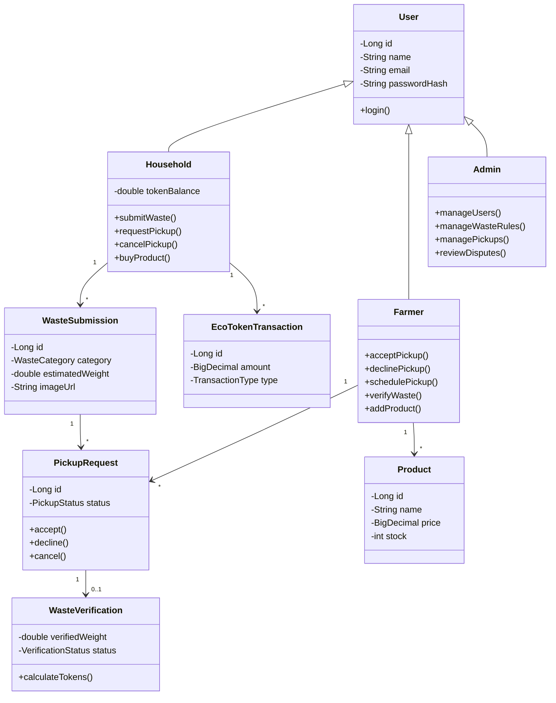

# AgroLoop

> **Bridging Waste Management, Agriculture, and Sustainable Commerce**

AgroLoop is a Java Spring Boot web application designed to connect households and farmers through a circular economy model. Households submit organic waste for collection, farmers verify and collect waste for composting and soil enrichment, and contributors earn **EcoTokens** redeemable in a sustainable marketplace.

---

📚 **[Comprehensive Developer Documentation Hub & Freshers Guide](./docs/INDEX.md)**  
*Complete setup guide (how to install Java, how to install Docker, start the project on Windows/Mac, OOP principles, and deep-dive documentation for all modules).*

---


## Tech Stack

- **Backend:** Java (JDK 21+ / Temurin 26), Spring Boot 3.x (Spring MVC, Spring Data JPA, Spring Validation)
- **Database:** PostgreSQL (running in Docker)
- **Frontend / Templating:** Thymeleaf, HTML5, CSS3, JavaScript
- **Build Tool:** Maven 3.9+
- **File Storage:** Local multipart storage (with transition path to cloud object storage)
- **AI Classification:** Multi-modal waste classification (final phase)

---

## Object-Oriented Principles in AgroLoop

- **Encapsulation:** User identity, token balances, and waste lifecycle states are encapsulated inside model classes. Mutations happen through domain methods (`accept()`, `decline()`, `verifyWaste()`, `calculateTokens()`).
- **Inheritance:** A polymorphic `User` base entity (`@Inheritance(strategy = InheritanceType.JOINED)`) extended by `Household`, `Farmer`, and `Admin`.
- **Polymorphism:** Strategy interfaces (`TokenCalculator`, `WasteMatcher`) allowing interchangeable business algorithms.
- **Abstraction:** Controllers call business services (`UserService`, `WasteSubmissionService`, etc.) rather than manipulating repositories or entities directly.

---

## Package Structure

```
AgroLoop/
├── src/main/java/com/agroloop/
│   ├── AgroLoopApplication.java
│   ├── config/             # Security, beans, and MVC configs
│   ├── controller/         # Web/Thymeleaf controllers
│   ├── service/            # Business logic and service interfaces
│   ├── repository/         # Spring Data JPA repositories
│   ├── model/              # OOP Domain classes with Inheritance
│   │   ├── User.java
│   │   ├── Household.java
│   │   ├── Farmer.java
│   │   ├── Admin.java
│   │   ├── WasteSubmission.java
│   │   ├── PickupRequest.java
│   │   ├── WasteVerification.java
│   │   ├── EcoTokenTransaction.java
│   │   └── Product.java
│   ├── dto/                # Validation and form transfer objects
│   └── exception/          # Custom domain exceptions
├── src/main/resources/
│   ├── application.properties
│   ├── static/             # CSS & JS assets
│   └── templates/          # Thymeleaf templates
├── pom.xml
└── docker-compose.yml
```

---

## Core Class Relationships



---

## Architecture Flow

```
                       Browser (Thymeleaf Templates)
                                     │
                                     ▼
                    Spring Boot Controllers (Web / MVC)
                                     │
                                     ▼
                      Service Layer (Abstraction & OOP)
                                     │
                                     ▼
                      Repositories (Spring Data JPA)
                                     │
                                     ▼
                   PostgreSQL Database (Docker / Joined Tables)
```

---

## Critical Business Rules

1. **Authenticated Access:** Only authenticated users can submit waste and view personalized dashboards.
2. **Pickup Assignment & Verification:** Only assigned farmers can inspect, accept, and verify pickups.
3. **Reward Preconditions:** Waste must be collected and verified before EcoToken rewards are credited.
4. **Idempotent Rewards:** Each verified pickup triggers exactly one token reward transaction.
5. **Marketplace Integrity:** Token purchases validate real-time token balance and product inventory under transaction isolation.

---

## Git Branch & Promotion Strategy

All development is performed on feature branches, integrated initially into `dev`, and promoted to `main` only after review and verification:

```
main (stable releases / production)
└── dev (active development & integration)
    ├── feature/project-setup
    ├── feature/user-management
    ├── feature/waste-submission
    ├── feature/pickup-verification
    ├── feature/ecotokens
    ├── feature/marketplace
    └── feature/admin-testing
```

Workflow:
1. Develop features on `feature/<phase-name>`.
2. Push and merge verified features into `dev`.
3. Conduct testing and review on `dev`.
4. Merge `dev` into `main` for milestone releases.

For detailed phase tracking and implementation milestones, see [ROADMAP.md](./ROADMAP.md).


---

## Getting Started

### Prerequisites
- **Java:** JDK 21+ (e.g. OpenJDK 21 or Temurin 26)
- **Docker & Docker Compose:** For running PostgreSQL (and optional containerized app)
- **Git**

---

### Method 1: Running the Application Locally (Recommended for Development)

#### Step 1: Start PostgreSQL in Docker
If PostgreSQL is not already running on your machine, start the database service using Docker Compose:

```bash
docker compose up -d postgres
```

> **Note:** The default connection configuration is:
> - **Host:** `localhost:5432`
> - **Database:** `agroloop`
> - **User:** `postgres`
> - **Password:** `7200`
> - **JDBC URL:** `jdbc:postgresql://localhost:5432/agroloop`

#### Step 2: Configure Environment (Optional)
The project includes a pre-configured `.env` and default values in `application.properties`. To customize settings (e.g. port or database credentials), copy `.env.example` to `.env`:

```bash
cp .env.example .env
```

#### Step 3: Start the Application

- **On macOS / Linux:**
  ```bash
  ./run.sh
  ```
  *(Or directly via the Maven wrapper: `./mvnw spring-boot:run`)*

- **On Windows (Command Prompt / PowerShell):**
  ```cmd
  run.bat
  ```
  *(Or directly via the Maven wrapper: `mvnw.cmd spring-boot:run`)*

#### Step 4: Access the Application
Once started, navigate to:
👉 **[http://localhost:8080](http://localhost:8080)**

You will see the AgroLoop homepage with a green **PostgreSQL Connected** status badge, overview of stakeholder portals (Household, Farmer, Admin), and the 12-phase roadmap progress tracker.

#### Default Credentials Reference

| Service / Role | Username / Email | Password | URL / Port | Purpose |
| :--- | :--- | :--- | :--- | :--- |
| **PostgreSQL** | `postgres` | `7200` | `localhost:5432` / `agroloop` | Core relational database |
| **pgAdmin (Optional)** | `admin@agroloop.local` | `admin` | `http://localhost:5055` | DB Admin UI (`--profile tools`) |
| **App: Admin** | `admin@agroloop.com` | `admin123` | `http://localhost:8080/login` | System administrator dashboard |
| **App: Household** | `household@agroloop.com` | `household123` | `http://localhost:8080/login` | Household waste submission & wallet |
| **App: Farmer** | `farmer@agroloop.com` | `farmer123` | `http://localhost:8080/login` | Farmer pickup & verification portal |

---

### Method 2: Running Everything in Docker (App + Database)

To build and run the entire stack (PostgreSQL database and Spring Boot Java server) in isolated Docker containers:

```bash
# Build and run in detached mode
docker compose up --build -d

# View live application logs
docker compose logs -f app

# Stop the containers
docker compose down
```

---

### Running Automated Tests

Run the test suite locally to verify database connectivity and web routes:

- **macOS / Linux:**
  ```bash
  ./mvnw test
  ```

- **Windows:**
  ```cmd
  mvnw.cmd test
  ```


