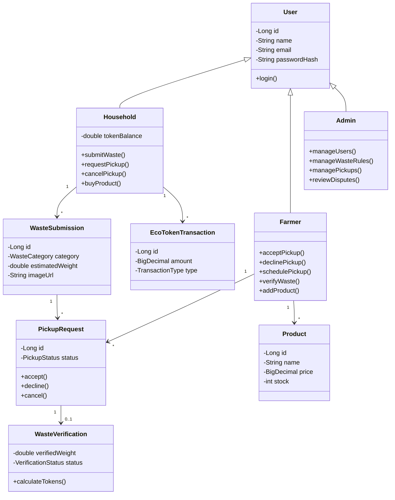

# AgroLoop — Development Roadmap

Java Spring Boot web application with PostgreSQL, Thymeleaf, and object-oriented domain architecture. The application bridges households and farmers in a circular waste-to-reward ecosystem.

---

## 1. OOP Principles in AgroLoop

- **Encapsulation:** User data, waste submission states, verification results, and token balances are strictly encapsulated within private fields. State transitions are controlled via explicit domain methods (e.g., `accept()`, `verifyWaste()`, `creditTokens()`).
- **Inheritance:** A polymorphic `User` base entity (`@Inheritance(strategy = InheritanceType.JOINED)`) defines common security and identity attributes, extended by specialized classes:
  - `Household extends User`
  - `Farmer extends User`
  - `Admin extends User`
- **Polymorphism:** Core operational logic is decoupled through interfaces, such as `TokenCalculator` (for category/quality-based token calculation algorithms) and `WasteMatcher` (for matching waste submissions to appropriate farmers based on capacity/distance).
- **Abstraction:** Database persistence and transactional complexity are hidden behind cleanly defined service interfaces. Web controllers communicate exclusively through services and DTOs rather than mutating entities directly.

---

## 2. Project Architecture & Package Layout

```
AgroLoop/
├── src/main/java/com/agroloop/
│   ├── AgroLoopApplication.java
│   ├── config/             # Spring Security, MVC, and Data bootstrapping
│   ├── controller/         # Web and REST controllers
│   ├── service/            # Business logic and abstraction interfaces
│   ├── repository/         # Spring Data JPA repositories
│   ├── model/              # OOP Domain entities (Inheritance & Encapsulation)
│   │   ├── User.java
│   │   ├── Household.java
│   │   ├── Farmer.java
│   │   ├── Admin.java
│   │   ├── WasteSubmission.java
│   │   ├── PickupRequest.java
│   │   ├── WasteVerification.java
│   │   ├── EcoTokenTransaction.java
│   │   └── Product.java
│   ├── dto/                # Data Transfer Objects & form validation models
│   └── exception/          # Custom domain and validation exceptions
├── src/main/resources/
│   ├── application.properties
│   ├── static/             # CSS stylesheets and client scripts
│   └── templates/          # Thymeleaf UI views
├── pom.xml
└── docker-compose.yml
```

---

## 3. Core Class Relationships (UML Class Diagram)



---

## 4. Development Phases

| # | Phase | Focus | Status | Milestone / Key Deliverables |
| :---: | :--- | :--- | :---: | :--- |
| **1** | **Project Setup** | Foundation | ✅ Completed | Spring Boot 3.3.4, PostgreSQL Docker setup, cross-platform scripts (`run.sh`, `run.bat`), Thymeleaf initial view, and test suite. |
| **2** | **User Management** | OOP Domain & Security | 🟡 In Progress | Implement `User`, `Household`, `Farmer`, and `Admin` using JPA inheritance, Spring Security, BCrypt, registration/login flows, and role segregation. |
| **3** | **Waste Submission** | Domain & Uploads | ⚪ Planned | `WasteSubmission`, category taxonomy, `MultipartFile` photo upload with validation, and household submission dashboards. |
| **4** | **Pickup & Verification** | State Machine & Rules | ⚪ Planned | `PickupRequest` lifecycle (`accept()`, `decline()`, `cancel()`), `WasteVerification` (`verifiedWeight`, quality grading, photo inspection). |
| **5** | **Eco-Tokens** | Polymorphism & Rewards | ⚪ Planned | `TokenCalculator` polymorphic strategy, atomic `EcoTokenTransaction` logging, household balance updates. |
| **6** | **Marketplace** | E-Commerce & Inventory | ⚪ Planned | `Product` listings by farmers, shopping cart, checkout via EcoTokens, atomic inventory reduction. |
| **7** | **Admin & Testing** | Governance & Hardening | ⚪ Planned | Admin oversight (`manageUsers()`, `manageWasteRules()`, `reviewDisputes()`), comprehensive JUnit and MockMvc integration tests. |

---

## 5. Critical Business & OOP Rules

1. **Strict Encapsulation:** Entities must not expose raw mutable collections or direct state updates without validation. State mutations must occur through domain methods (e.g. `accept()`, `verifyWaste()`).
2. **Inheritance Integrity:** Common identity, credential checking, and authorization live in `User`. Role-specific attributes and behaviors reside strictly in `Household`, `Farmer`, or `Admin`.
3. **Transactional Preconditions:** A verification must pass before tokens can be minted.
4. **Idempotent Rewards:** Each verified pickup triggers exactly one token award transaction.
5. **Solvency & Stock Isolation:** Marketplace purchases require sufficient token balance and concurrent stock safety.
