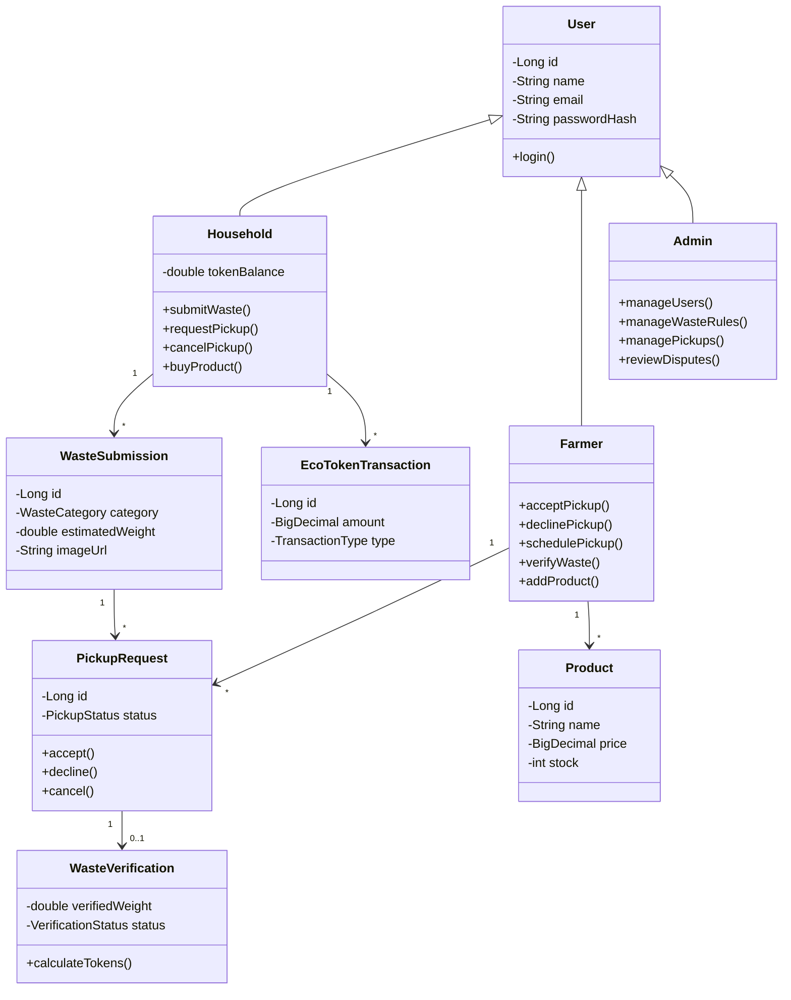

# AgroLoop — Development Roadmap

Java Spring Boot web application with PostgreSQL, Thymeleaf, and object-oriented domain architecture. The application bridges households and farmers in a circular waste-to-reward ecosystem.

---

## 1. OOP Principles in AgroLoop

- **Encapsulation:** User data, waste submission states, verification results, and token balances are strictly encapsulated within private fields. State transitions are controlled via explicit domain methods (e.g., `accept()`, `verifyWaste()`, `creditTokens()`).
- **Inheritance:** A polymorphic `User` base entity (`@Inheritance(strategy = InheritanceType.JOINED)`) defines common security and identity attributes, extended by specialized classes:
  - `Household extends User`
  - `Farmer extends User`
  - `Admin extends User`
- **Polymorphism:** Core operational logic is decoupled through interfaces, such as `TokenCalculator` (for category/quality-based token calculation algorithms) and `WasteMatcher` (for matching waste submissions to appropriate farmers based on capacity/distance).
- **Abstraction:** Database persistence and transactional complexity are hidden behind cleanly defined service interfaces. Web controllers communicate exclusively through services and DTOs rather than mutating entities directly.

---

## 2. Project Architecture & Package Layout

```
AgroLoop/
├── src/main/java/com/agroloop/
│   ├── AgroLoopApplication.java
│   ├── config/             # Spring Security, MVC, and Data bootstrapping
│   ├── controller/         # Web and REST controllers
│   ├── service/            # Business logic and abstraction interfaces
│   ├── repository/         # Spring Data JPA repositories
│   ├── model/              # OOP Domain entities (Inheritance & Encapsulation)
│   │   ├── User.java
│   │   ├── Household.java
│   │   ├── Farmer.java
│   │   ├── Admin.java
│   │   ├── WasteSubmission.java
│   │   ├── PickupRequest.java
│   │   ├── WasteVerification.java
│   │   ├── EcoTokenTransaction.java
│   │   └── Product.java
│   ├── dto/                # Data Transfer Objects & form validation models
│   └── exception/          # Custom domain and validation exceptions
├── src/main/resources/
│   ├── application.properties
│   ├── static/             # CSS stylesheets and client scripts
│   └── templates/          # Thymeleaf UI views
├── pom.xml
└── docker-compose.yml
```

---

## 3. Core Class Relationships (UML Class Diagram)



---

## 4. Development Phases

| # | Phase | Focus | Status | Milestone / Key Deliverables |
| :---: | :--- | :--- | :---: | :--- |
| **1** | **Project Setup** | Foundation | ✅ Completed | Spring Boot 3.3.4, PostgreSQL Docker setup, cross-platform scripts (`run.sh`, `run.bat`), Thymeleaf initial view, and test suite. |
| **2** | **User Management & Security** | OOP Domain & Security | ✅ Completed | JPA Joined Inheritance (`User`, `Household`, `Farmer`, `Admin`), Spring Security, BCrypt hashing, public registration defaulting to Household, Farmer conversion request workflow with Admin review/approval, brand logo integration, Flyway migrations (`V1`, `V2`), and 22 passing automated tests. |
| **3** | **Waste Submission** | Domain & Uploads | ✅ Completed | `WasteSubmission` domain entity with `BigDecimal` weight, `WasteCategory` taxonomy & multipliers, `SubmissionStatus` lifecycle, address fallback logic, secure `FileStorageService` with server-side UUID naming & traversal guards, Flyway migration `V3`, responsive household dashboard submission UI with live history, and 49 passing tests. |
| **4** | **Pickup & Verification** | State Machine & Rules | ✅ Completed | `PickupRequest` state machine (`accept()`, `schedule()`, `markCollected()`, `recordVerification()`, `decline()`, `cancel()`), optimistic locking (`@Version`), audit timestamps (`declinedAt`), `QualityGrade` grading strategy, `WasteVerification` entity, Flyway migration `V4`, `PickupService`, Farmer claim & scheduling queue, verification forms, household logistics tracking & cancellation, cross-household security, and 110 passing tests. |
| **5** | **Eco-Tokens** | Polymorphism & Rewards | ✅ Completed | Polymorphic `TokenCalculator` strategy (`StandardTokenCalculator`, `PromotionalTokenCalculator`), immutable `EcoTokenTransaction` ledger, `V5` Flyway migration, pessimistic write locking (`findByIdForUpdate`), idempotent reward minting, household dashboard ledger UI, and passing automated tests. |
| **6** | **Marketplace** | E-Commerce & Inventory | ✅ Completed | Farmer product catalog management & soft-archive lifecycle, session-backed cart management, authoritative DB pricing, deterministic dual-phase pessimistic locking (`Household` row lock -> ascending `Product` ID locks), deadlock prevention, atomic checkout transaction (`Product` stock deduction, `Household` token debit, `Order` & `OrderItem` historical snapshots, `MARKETPLACE_PURCHASE` ledger entry with DB matrix check), `V6` Flyway migration, Thymeleaf UI views (marketplace catalog, product details, cart, checkout, order history/details, farmer product management & sales order queue), and 61 new tests (188 total passing suite). |

| **7** | **Admin & Testing** | Governance & Hardening | ⚪ Planned | Admin oversight (`manageUsers()`, `manageWasteRules()`, `reviewDisputes()`), comprehensive JUnit and MockMvc integration tests. |

---

## 5. Critical Business & Development Policies

1. **Mandatory Living Documentation & File Mapping Policy:**
   - **Continuous Documentation Updates:** After each feature or change is implemented, the documentation hub (`docs/INDEX.md`) and the relevant integration module document must be updated immediately.
   - **Clickable File Structure:** Every document must maintain an exhaustive, clickable repository file tree linking directly to the code files.
   - **Function-Level Transparency:** Documentation must explain the exact responsibilities, classes, and methods within each file so any developer or fresher can understand the architecture without reverse-engineering.
   - **Visual System Mappings:** Include architecture and sequence diagrams demonstrating how data flows from UI views through controllers, services, repositories, and database tables.
2. **Strict Encapsulation:** Entities must not expose raw mutable collections or direct state updates without validation. State mutations must occur through domain methods (e.g. `accept()`, `verifyWaste()`, `addTokens()`, `spendTokens()`).
3. **Inheritance Integrity:** Common identity, credential checking, and authorization live in `User`. Role-specific attributes and behaviors reside strictly in `Household`, `Farmer`, or `Admin`.
4. **Transactional Preconditions:** A verification must pass before tokens can be minted.
5. **Idempotent Rewards:** Each verified pickup triggers exactly one token award transaction.
6. **Solvency & Stock Isolation:** Marketplace purchases require sufficient token balance and concurrent stock safety.

