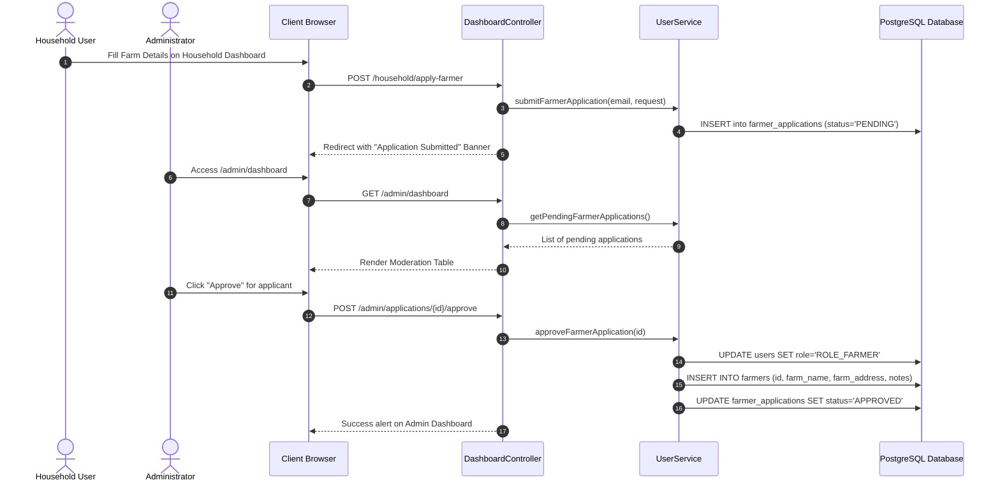

# Module 02: User Management & Authentication

[← Back to Master Documentation Hub](../INDEX.md)

---

## 1. Overview & Concept

AgroLoop unites three distinct ecosystem stakeholders: **Households**, **Farmers**, and **Admins**. In **Phase 2: User Management**, we implement the domain entity hierarchy using JPA Joined Inheritance, Spring Security, BCrypt password encryption, registration flows, and role-based dashboard redirection.

---

## 2. Object-Oriented Principles in this Module

### Encapsulation
- All fields in `User`, `Household`, `Farmer`, and `Admin` are marked `private`.
- No raw public password setter exists; only hashed credentials (`updatePasswordHash()`) are accepted.
- Token balance in `Household` cannot be mutated directly from outside; updates must pass through domain validation methods:
  - `addTokens(BigDecimal amount)`: Enforces positive value.
  - `spendTokens(BigDecimal amount)`: Enforces solvency check (`tokenBalance >= amount`).

### Inheritance
- **Base Entity:** `User` provides common fields (`id`, `name`, `email`, `passwordHash`, `role`, `enabled`, `createdAt`, `updatedAt`).
- **JPA Joined Table Strategy:**
  ```java
  @Entity
  @Table(name = "users")
  @Inheritance(strategy = InheritanceType.JOINED)
  public abstract class User { ... }
  ```
- **Specialized Subclasses:**
  - `Household extends User`: Owns `tokenBalance` and `address`.
  - `Farmer extends User`: Owns `farmName`, `farmAddress`, and `notes`.
  - `Admin extends User`: Holds administrative capabilities.

### Polymorphism
- Spring Data JPA repositories allow polymorphic queries on `User` while returning concrete runtime instances (`Household`, `Farmer`, or `Admin`).
- `UserService.registerUser(RegisterRequest req)` instantiates the appropriate concrete subclass at runtime based on the requested role.

### Abstraction
- Controllers do not execute JPA queries or handle password encryption directly.
- All registration, validation, and user lookups are hidden behind `UserService` and `CustomUserDetailsService`.

---

## 3. Database Schema Mapping

```
                       ┌────────────────────────┐
                       │         users          │ (Parent Table)
                       ├────────────────────────┤
                       │ id (PK)                │
                       │ name                   │
                       │ email (UNIQUE)         │
                       │ password_hash          │
                       │ role (ENUM STRING)     │
                       │ enabled                │
                       │ created_at             │
                       │ updated_at             │
                       └───────────┬────────────┘
                                   │
         ┌─────────────────────────┼─────────────────────────┐
         │                         │                         │
         ▼                         ▼                         ▼
┌───────────────────┐    ┌───────────────────┐    ┌───────────────────┐
│    households     │    │      farmers      │    │      admins       │
├───────────────────┤    ├───────────────────┤    ├───────────────────┤
│ id (PK, FK)       │    │ id (PK, FK)       │    │ id (PK, FK)       │
│ token_balance     │    │ farm_name         │    └───────────────────┘
│ address           │    │ farm_address      │
└───────────────────┘    │ notes             │
                         └───────────────────┘
```

---

---

## 4. Security, Registration & Role Conversion Architecture

### 4.1 Default Role Policy (Household)
To maintain security, quality standards, and verified agricultural partners, **all public registrations default to `ROLE_HOUSEHOLD`**. Public self-registration directly into `ROLE_FARMER` or `ROLE_ADMIN` is prohibited.
1. Citizen fills [`/register`](../../src/main/resources/templates/register.html) with Name, Email, Address, and Password.
2. [`RegisterRequest.java`](../../src/main/java/com/agroloop/dto/RegisterRequest.java) enforces Jakarta validations (`@NotBlank`, `@Email`, password match).
3. [`UserServiceImpl.registerHousehold()`](../../src/main/java/com/agroloop/service/UserServiceImpl.java) hashes the password via `BCryptPasswordEncoder` and persists a concrete `Household` instance.
4. User logs in at [`/login`](../../src/main/resources/templates/login.html) and is automatically routed to [`/household/dashboard`](../../src/main/resources/templates/dashboard/household.html) by [`CustomAuthenticationSuccessHandler`](../../src/main/java/com/agroloop/config/CustomAuthenticationSuccessHandler.java).

### 4.2 Farmer Role Conversion & Admin Approval Flow
If a household member operates a farm or composting facility:
1. They submit the **"Apply to Become a Farmer"** form on their dashboard (`POST /household/apply-farmer`).
2. A [`FarmerApplication`](../../src/main/java/com/agroloop/model/FarmerApplication.java) is persisted in `PENDING` status. The dashboard displays a live status alert.
3. An administrator visits [`/admin/dashboard`](../../src/main/resources/templates/dashboard/admin.html) where the **Moderation Queue** lists all pending conversion requests.
4. **On Approval (`POST /admin/applications/{id}/approve`)**:
   - Application status updates to `APPROVED`.
   - The user's role in `users` is updated to `ROLE_FARMER`.
   - A joined record in the `farmers` table is created with the verified `farm_name`, `farm_address`, and `notes`.
   - The Hibernate persistence context cache is flushed and cleared.
   - On subsequent logins, the user is authenticated as `ROLE_FARMER` and seamlessly routed to the Farmer Agro Portal (`/farmer/dashboard`).
5. **On Rejection (`POST /admin/applications/{id}/reject`)**:
   - Application status updates to `REJECTED` with the admin's explanation. The user remains an active Household.



---

## 5. Module 02 File Structure & Detailed Function Reference

Click on any file link below to view the source code and implementation:

| File | Type | Classes / Interfaces | Functions & Responsibilities |
| :--- | :--- | :--- | :--- |
| **[`Role.java`](../../src/main/java/com/agroloop/model/Role.java)** | Domain Enum | `Role` | Defines enum values `ROLE_HOUSEHOLD`, `ROLE_FARMER`, `ROLE_ADMIN`. |
| **[`User.java`](../../src/main/java/com/agroloop/model/User.java)** | Base Entity | `User` | Abstract class with `@Inheritance(strategy = InheritanceType.JOINED)`. Defines `id`, `name`, `email`, `passwordHash`, `role`, `enabled`, timestamps, `@PrePersist`, `@PreUpdate`. |
| **[`Household.java`](../../src/main/java/com/agroloop/model/Household.java)** | Joined Entity | `Household extends User` | Maps to `households` table. Domain operations: `addTokens(BigDecimal)`, `spendTokens(BigDecimal)`, `updateAddress(String)`. |
| **[`Farmer.java`](../../src/main/java/com/agroloop/model/Farmer.java)** | Joined Entity | `Farmer extends User` | Maps to `farmers` table. Domain operations: `updateFarmDetails(farmName, farmAddress, notes)`. |
| **[`Admin.java`](../../src/main/java/com/agroloop/model/Admin.java)** | Joined Entity | `Admin extends User` | Maps to `admins` table. Represents system administrators. |
| **[`FarmerApplicationStatus.java`](../../src/main/java/com/agroloop/model/FarmerApplicationStatus.java)** | Domain Enum | `FarmerApplicationStatus` | Defines `PENDING`, `APPROVED`, `REJECTED`. |
| **[`FarmerApplication.java`](../../src/main/java/com/agroloop/model/FarmerApplication.java)** | Domain Entity | `FarmerApplication` | Tracks conversion applications. Domain methods: `approve()`, `reject(reason)`. |
| **[`UserRepository.java`](../../src/main/java/com/agroloop/repository/UserRepository.java)** | JPA Repo | `UserRepository` | Queries base `User`: `findByEmail(String)`, `existsByEmail(String)`. |
| **[`HouseholdRepository.java`](../../src/main/java/com/agroloop/repository/HouseholdRepository.java)** | JPA Repo | `HouseholdRepository` | Queries `Household` by email. |
| **[`FarmerRepository.java`](../../src/main/java/com/agroloop/repository/FarmerRepository.java)** | JPA Repo | `FarmerRepository` | Queries `Farmer` by email. |
| **[`AdminRepository.java`](../../src/main/java/com/agroloop/repository/AdminRepository.java)** | JPA Repo | `AdminRepository` | Queries `Admin` by email. |
| **[`FarmerApplicationRepository.java`](../../src/main/java/com/agroloop/repository/FarmerApplicationRepository.java)** | JPA Repo | `FarmerApplicationRepository` | Queries: `findByStatusOrderByCreatedAtDesc()`, `findTopByUserIdOrderByCreatedAtDesc()`, `existsByUserIdAndStatus()`. |
| **[`RegisterRequest.java`](../../src/main/java/com/agroloop/dto/RegisterRequest.java)** | DTO | `RegisterRequest` | Form validation backing object for sign-up: `name`, `email`, `password`, `confirmPassword`, `address`, `isPasswordMatching()`. |
| **[`FarmerApplicationRequest.java`](../../src/main/java/com/agroloop/dto/FarmerApplicationRequest.java)** | DTO | `FarmerApplicationRequest` | Form validation backing object for conversion: `farmName`, `farmAddress`, `notes`. |
| **[`UserService.java`](../../src/main/java/com/agroloop/service/UserService.java)** | Service Interface | `UserService` | Declares business contracts for user registration, application submission, approval, and rejection. |
| **[`UserServiceImpl.java`](../../src/main/java/com/agroloop/service/UserServiceImpl.java)** | Service Impl | `UserServiceImpl` | Implements `registerHousehold()`, `submitFarmerApplication()`, `approveFarmerApplication()` (with native transactional role conversion and cache eviction), and `rejectFarmerApplication()`. |
| **[`CustomUserDetailsService.java`](../../src/main/java/com/agroloop/service/CustomUserDetailsService.java)** | Security Service | `CustomUserDetailsService` | Implements `loadUserByUsername(String email)`. Translates `User` entity to Spring Security's `UserDetails`. |
| **[`SecurityConfig.java`](../../src/main/java/com/agroloop/config/SecurityConfig.java)** | Security Config | `SecurityConfig` | Defines `SecurityFilterChain`, `BCryptPasswordEncoder`, `DaoAuthenticationProvider`, and URL access rules (`/admin/**`, `/farmer/**`, `/household/**`, `/register/**`). |
| **[`CustomAuthenticationSuccessHandler.java`](../../src/main/java/com/agroloop/config/CustomAuthenticationSuccessHandler.java)** | Security Handler | `CustomAuthenticationSuccessHandler` | Routes users post-login to their role dashboard. |
| **[`DataInitializer.java`](../../src/main/java/com/agroloop/config/DataInitializer.java)** | Bootstrap | `DataInitializer` | Automatically seeds demo accounts (`admin@agroloop.com`, `household@agroloop.com`, `farmer@agroloop.com`) on startup. |
| **[`AuthController.java`](../../src/main/java/com/agroloop/controller/AuthController.java)** | Controller | `AuthController` | Serves `GET /login`, `GET /register`, and processes `POST /register`. |
| **[`DashboardController.java`](../../src/main/java/com/agroloop/controller/DashboardController.java)** | Controller | `DashboardController` | Serves dashboards, handles `POST /household/apply-farmer`, `POST /admin/applications/{id}/approve`, and `POST /admin/applications/{id}/reject`. |
| **[`register.html`](../../src/main/resources/templates/register.html)** | Template | HTML View | Public registration form with brand logo, default Household explanation, and error alerts. |
| **[`login.html`](../../src/main/resources/templates/login.html)** | Template | HTML View | Login form with brand logo, demo quick-fill buttons, registration link, and success/error notifications. |
| **[`dashboard/household.html`](../../src/main/resources/templates/dashboard/household.html)** | Template | HTML View | Household portal showing EcoToken balance, pickup address, pending application alert, and farmer conversion form. |
| **[`dashboard/farmer.html`](../../src/main/resources/templates/dashboard/farmer.html)** | Template | HTML View | Farmer agro portal showing farm profile, collection summary, and produce listing placeholders. |
| **[`dashboard/admin.html`](../../src/main/resources/templates/dashboard/admin.html)** | Template | HTML View | Admin moderation portal showing system statistics and the Farmer Conversion Applications table with Approve/Reject actions. |

---

## 6. Database Migration Scripts (Flyway)

AgroLoop utilizes **Flyway** for database versioning and migrations located in `src/main/resources/db/migration/`:

- **[`V1__create_user_tables.sql`](../../src/main/resources/db/migration/V1__create_user_tables.sql)**:
  - Generates the `users` base table with constraints and an index on `email`.
  - Generates the joined subtype tables (`households`, `farmers`, `admins`) with foreign keys referencing `users(id)` and cascading deletes.
- **[`V2__create_farmer_applications_table.sql`](../../src/main/resources/db/migration/V2__create_farmer_applications_table.sql)**:
  - Generates the `farmer_applications` table to track conversion requests, reasons, and review timestamps.
- **[`docker/init.sql`](file:///Users/rahul/Desktop/Projects/Personal/AgroLoop/docker/init.sql)**:
  - Complete standalone SQL script for fresh Docker container bootstrap.

---

## 7. User Data Seeding & Default Credentials

AgroLoop automatically seeds default demo users upon application startup using [`DataInitializer.java`](../../src/main/java/com/agroloop/config/DataInitializer.java) which implements Spring Boot's `CommandLineRunner`.

### Default Seeded Accounts:

| Role | Email | Password | Initial State / Details |
| :--- | :--- | :--- | :--- |
| **Admin** | `admin@agroloop.com` | `admin123` | System Administrator (ROLE_ADMIN) ➔ `/admin/dashboard` |
| **Household** | `household@agroloop.com` | `household123` | Alice Green (ROLE_HOUSEHOLD, 150.00 EcoTokens, Kochi address) ➔ `/household/dashboard` |
| **Farmer** | `farmer@agroloop.com` | `farmer123` | Bob Farmer (ROLE_FARMER, Green Valley Organic Farm, Wayanad) ➔ `/farmer/dashboard` |

---

## 8. Verification & Test Suite

Run all automated unit and integration tests:
```bash
mvn test
```

### Passing Tests (22 Tests):
- **[`UserRegistrationAndConversionTest.java`](../../src/test/java/com/agroloop/controller/UserRegistrationAndConversionTest.java)**:
  - `GET /register` renders registration page with logo and default Household notice.
  - `POST /register` creates a new Household account and redirects to login.
  - `POST /register` rejects password mismatch.
  - `POST /register` rejects duplicate email.
  - Household can submit application to become a Farmer.
  - Admin can approve pending farmer application and convert role to `ROLE_FARMER`.
  - Non-admin user cannot approve farmer applications (HTTP 403 Forbidden).
- **[`AuthControllerTest.java`](../../src/test/java/com/agroloop/controller/AuthControllerTest.java)**:
  - `GET /login` renders with demo credentials.
  - Role-based redirect tests for Admin, Household, and Farmer.
  - Bad credentials redirect to `/login?error`.
  - Access control and forbidden route tests.
- **[`UserModelTest.java`](../../src/test/java/com/agroloop/model/UserModelTest.java)**:
  - OOP encapsulation, token additions, token deductions, and solvency checks.
  - Subtype polymorphism and validation guards.
- **[`HomeControllerTest.java`](../../src/test/java/com/agroloop/controller/HomeControllerTest.java)** & **[`AgroLoopApplicationTests.java`](../../src/test/java/com/agroloop/AgroLoopApplicationTests.java)**:
  - Application context bootstrap and landing page diagnostics.

---

[← Back to Master Documentation Hub](../INDEX.md)


