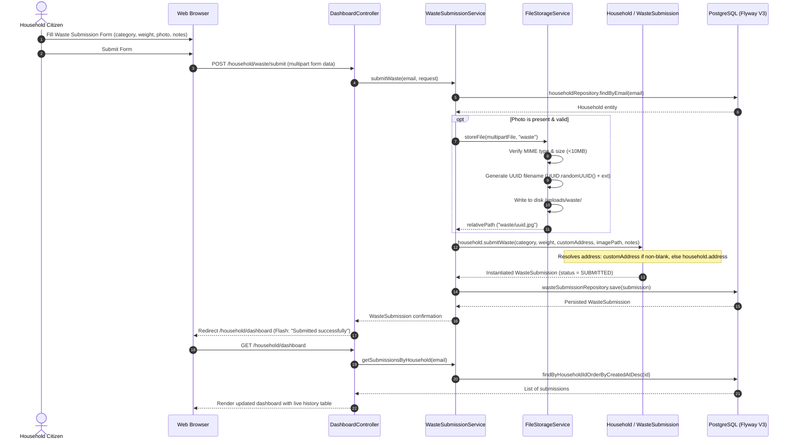

# Module 03: Waste Submission & Media Processing

[← Back to Master Documentation Hub](../INDEX.md)

---

## 1. Overview & Concept

In **Phase 3: Waste Submission & Media Processing**, household users register batches of segregated organic waste into the AgroLoop circular network. This creates the foundational demand records that farmer partners inspect, claim, collect, and compost in Phase 4.

Key functional capabilities include:
- **Taxonomy Categorization:** Standardized organic waste streams (`FOOD_SCRAPS`, `GARDEN_WASTE`, `AGRICULTURAL_ORGANIC`, `COFFEE_GROUNDS`) with baseline token reward multipliers.
- **Precision Weight Accounting:** Quantifying estimated biomass in kilograms using `BigDecimal` (`NUMERIC(10, 2)`) to eliminate binary floating-point rounding inaccuracies.
- **Intelligent Address Resolution:** Automatically defaulting pickup locations to the household's registered profile address, while allowing one-off custom pickup overrides.
- **Defensive Media Processing:** Optional multipart photographic upload with server-side UUID filename generation, strict MIME type whitelisting (`image/jpeg`, `image/png`, `image/webp`), and directory traversal prevention.
- **Real-Time Household History:** Live dashboard tracking with color-coded status badges and image thumbnail previews.

---

## 2. Object-Oriented Principles in this Module

### Encapsulation
- **Invariant Enforcement:** [`WasteSubmission`](../../src/main/java/com/agroloop/model/WasteSubmission.java) strictly encapsulates all lifecycle transitions (`markClaimed()`, `markCollected()`, `markVerified()`, `markRejected()`). Status cannot be manipulated arbitrarily via raw setters.
- **Domain Factory on Household:** Creation is initiated through [`household.submitWaste(...)`](../../src/main/java/com/agroloop/model/Household.java), preserving the relational integrity of the `Household -> WasteSubmission` association.
- **Terminal State Protection:** Terminal states (`VERIFIED`, `REJECTED`) reject subsequent mutations, preserving audit integrity.

### Abstraction
- **Storage Decoupling:** File operations are isolated behind the [`FileStorageService`](../../src/main/java/com/agroloop/service/storage/FileStorageService.java) interface. The service layer and controllers remain completely agnostic of underlying disk or cloud bucket storage mechanisms.

### Polymorphic Economics
- **Category Multipliers:** [`WasteCategory`](../../src/main/java/com/agroloop/model/WasteCategory.java) encapsulates distinct economic weight factors (e.g., Coffee Grounds `1.50x`, Food Scraps `1.00x`), feeding into Phase 5 token minting algorithms.

---

## 3. Architecture & Data Flow



---

## 4. State Machine & Address Resolution

### Submission Lifecycle States

```
                 ┌───────────┐
                 │ SUBMITTED │
                 └─────┬─────┘
                       │ (Farmer schedules pickup)
                       ▼
                 ┌───────────┐
                 │  CLAIMED  │
                 └─────┬─────┘
                       │ (Driver collects waste)
                       ▼
                 ┌───────────┐
                 │ COLLECTED │
                 └─────┬─────┘
                       │ (Quality inspection approved)
                       ▼
                 ┌───────────┐
                 │ VERIFIED  │  ◄── (Terminal state; triggers Phase 5 token minting)
                 └───────────┘

           (From any non-terminal state)
                       │
                       │ (Contamination or cancellation)
                       ▼
                 ┌───────────┐
                 │ REJECTED  │  ◄── (Terminal state; records rejection reason)
                 └───────────┘
```

### Address Inheritance Logic

```text
               customPickupAddress
                       │
             Is it null or blank?
                   /        \
                 YES         NO
                 /             \
                ▼               ▼
      household.getAddress()   customPickupAddress.trim()
                \               /
                 ▼             ▼
              WasteSubmission.pickupAddress
```

---

## 5. Security & Storage Defenses

1. **Path Traversal Defense:** All upload requests pass through strict normalization checks. Relative subdirectories and load paths cannot contain `..`, leading slashes, or point outside the configured root location.
2. **Server-Side File Renaming:** Client-provided file names are discarded. Stored files are named strictly with cryptographically random UUIDs (`UUID.randomUUID().toString() + extension`).
3. **MIME Whitelisting:** Permitted MIME types are restricted to `image/jpeg`, `image/png`, and `image/webp`. File sizes are capped at 10MB.
4. **Static Route Mapping:** The [`WebMvcConfig`](../../src/main/java/com/agroloop/config/WebMvcConfig.java) exposes `/uploads/**` from the local upload directory, while [`SecurityConfig`](../../src/main/java/com/agroloop/config/SecurityConfig.java) permits viewing media thumbnails for authenticated platform users.

---

## 6. Database Schema (Flyway V3)

```sql
CREATE TABLE IF NOT EXISTS waste_submissions (
    id BIGSERIAL PRIMARY KEY,
    household_id BIGINT NOT NULL,
    category VARCHAR(50) NOT NULL,
    estimated_weight NUMERIC(10, 2) NOT NULL,
    pickup_address VARCHAR(500) NOT NULL,
    image_path VARCHAR(500),
    notes VARCHAR(1000),
    status VARCHAR(30) NOT NULL DEFAULT 'SUBMITTED',
    rejection_reason VARCHAR(500),
    created_at TIMESTAMP WITHOUT TIME ZONE NOT NULL DEFAULT NOW(),
    updated_at TIMESTAMP WITHOUT TIME ZONE NOT NULL DEFAULT NOW(),
    CONSTRAINT fk_waste_submissions_household FOREIGN KEY (household_id) REFERENCES households(id) ON DELETE CASCADE,
    CONSTRAINT chk_waste_submissions_weight CHECK (estimated_weight > 0)
);

CREATE INDEX IF NOT EXISTS idx_waste_submissions_household_id ON waste_submissions(household_id);
CREATE INDEX IF NOT EXISTS idx_waste_submissions_status ON waste_submissions(status);
CREATE INDEX IF NOT EXISTS idx_waste_submissions_created_at ON waste_submissions(created_at DESC);
```

---

## 7. Component & File Catalog

| File Path | Layer | Role & Responsibility |
| :--- | :--- | :--- |
| **[`WasteCategory.java`](../../src/main/java/com/agroloop/model/WasteCategory.java)** | Domain Model | Categorization taxonomy enum with display names, descriptions, and baseline reward multipliers. |
| **[`SubmissionStatus.java`](../../src/main/java/com/agroloop/model/SubmissionStatus.java)** | Domain Model | Lifecycle state machine enum (`SUBMITTED`, `CLAIMED`, `COLLECTED`, `VERIFIED`, `REJECTED`). |
| **[`WasteSubmission.java`](../../src/main/java/com/agroloop/model/WasteSubmission.java)** | Domain Model | JPA entity mapped to `waste_submissions` with `BigDecimal` weight, address resolution, and state transition methods. |
| **[`Household.java`](../../src/main/java/com/agroloop/model/Household.java)** | Domain Model | Extended with `submitWaste(...)` domain factory method enforcing address fallback logic. |
| **[`FileStorageService.java`](../../src/main/java/com/agroloop/service/storage/FileStorageService.java)** | Storage Abstraction | Contract for storing, loading, and deleting uploaded files. |
| **[`LocalFileStorageServiceImpl.java`](../../src/main/java/com/agroloop/service/storage/LocalFileStorageServiceImpl.java)** | Storage Implementation | Local filesystem storage service enforcing UUID filenames, MIME checks, and traversal defense. |
| **[`WebMvcConfig.java`](../../src/main/java/com/agroloop/config/WebMvcConfig.java)** | Web Config | ResourceHandler mapping URL `/uploads/**` to disk storage location. |
| **[`SecurityConfig.java`](../../src/main/java/com/agroloop/config/SecurityConfig.java)** | Security Config | Permits `/uploads/**` for static image viewing. |
| **[`WasteSubmissionRepository.java`](../../src/main/java/com/agroloop/repository/WasteSubmissionRepository.java)** | Persistence | Spring Data JPA queries by household and status. |
| **[`V3__create_waste_submissions_table.sql`](../../src/main/resources/db/migration/V3__create_waste_submissions_table.sql)** | Migration | Flyway script establishing table, check constraints, foreign keys, and indexes. |
| **[`WasteSubmissionRequest.java`](../../src/main/java/com/agroloop/dto/WasteSubmissionRequest.java)** | DTO | Form validation bean with Jakarta constraints (`@NotNull`, `@DecimalMin`, `@DecimalMax`, `@Size`). |
| **[`WasteSubmissionService.java`](../../src/main/java/com/agroloop/service/WasteSubmissionService.java)** | Service Contract | Business interface for waste submission operations. |
| **[`WasteSubmissionServiceImpl.java`](../../src/main/java/com/agroloop/service/WasteSubmissionServiceImpl.java)** | Service Logic | Transactional service managing file upload, household resolution, and entity persistence. |
| **[`DashboardController.java`](../../src/main/java/com/agroloop/controller/DashboardController.java)** | Web Controller | Handles `POST /household/waste/submit` and provides data to `householdDashboard`. |
| **[`household.html`](../../src/main/resources/templates/dashboard/household.html)** | UI View | Thymeleaf view with submit form, live count card, and submissions history table. |
| **[`WasteSubmissionModelTest.java`](../../src/test/java/com/agroloop/model/WasteSubmissionModelTest.java)** | Test Suite | Unit tests for domain models, state transitions, and address fallback invariants. |
| **[`WasteSubmissionRepositoryTest.java`](../../src/test/java/com/agroloop/repository/WasteSubmissionRepositoryTest.java)** | Test Suite | DataJpaTest verifying queries and database constraints. |
| **[`FileStorageServiceTest.java`](../../src/test/java/com/agroloop/service/FileStorageServiceTest.java)** | Test Suite | Unit tests verifying UUID naming, traversal rejection, and MIME checking. |
| **[`WasteSubmissionServiceTest.java`](../../src/test/java/com/agroloop/service/WasteSubmissionServiceTest.java)** | Test Suite | Mockito unit tests verifying service workflows and address inheritance. |
| **[`WasteSubmissionIntegrationTest.java`](../../src/test/java/com/agroloop/controller/WasteSubmissionIntegrationTest.java)** | Test Suite | MockMvc integration tests for HTTP multipart submission, authorization, and dashboard rendering. |

---

[← Back to Master Documentation Hub](../INDEX.md)
