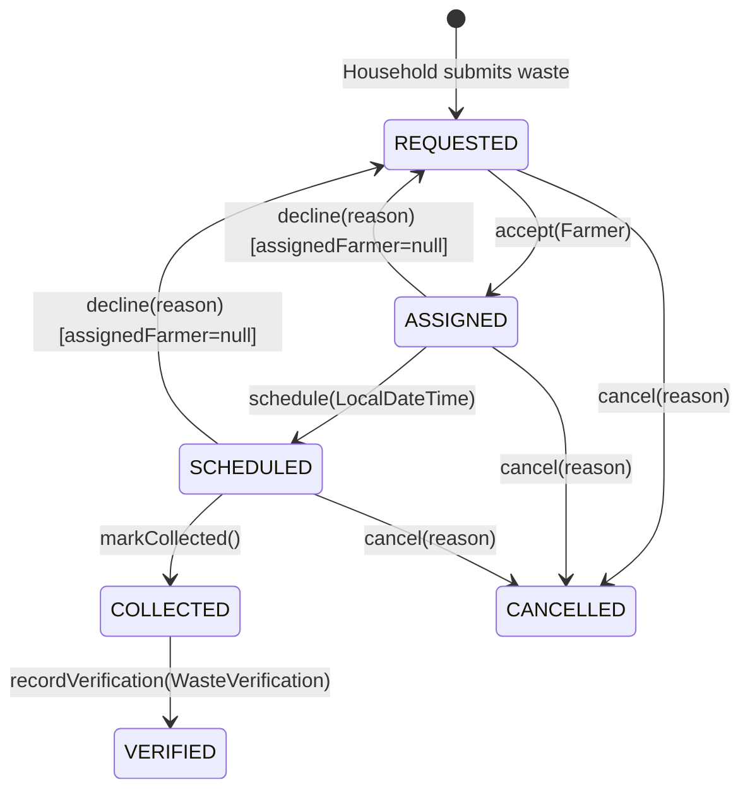

# Module 04: Pickup Management & Verification Engine

[← Back to Master Documentation Hub](../INDEX.md)

---

## 1. Overview & Concept

In **Phase 4: Pickup Management & Verification Engine**, AgroLoop connects households and farmers through an operational logistics pipeline:
1. **Pickup Discovery & Claiming**: Unclaimed organic waste submissions appear in the community pickup queue for certified farmers to claim (`accept()`).
2. **Collection Appointment Scheduling**: Claimed pickups are scheduled with a target collection window (`schedule()`), with future-date validation enforced at the domain entity level.
3. **Physical Retrieval**: Farmers record physical collection (`markCollected()`), advancing the state from `SCHEDULED` to `COLLECTED`.
4. **Quality Verification & Grading**: The assigned farmer conducts on-site inspection, recording actual measured weight and quality grading (`GRADE_A`, `GRADE_B`, `GRADE_C`, `REJECTED`) via `WasteVerification`.
5. **Re-queue & Cancellation Invariants**: Farmers can decline an assignment prior to collection, cleanly resetting it to `REQUESTED` with audit reasons, while households retain cancellation rights before physical retrieval occurs.

---

## 2. Object-Oriented Principles in this Module

### Encapsulation & Domain State Machine
- `PickupRequest` strictly encapsulates its status and internal timestamps. Public setter methods for state variables are banned.
- All state transitions execute exclusively through domain business methods:
  - `accept(Farmer farmer)`: Transitions `REQUESTED` ➔ `ASSIGNED`.
  - `schedule(LocalDateTime slot)`: Transitions `ASSIGNED` / `SCHEDULED` ➔ `SCHEDULED`.
  - `markCollected()`: Transitions `SCHEDULED` ➔ `COLLECTED`.
  - `recordVerification(WasteVerification verification)`: Transitions `COLLECTED` ➔ `VERIFIED`.
  - `decline(String reason)`: Resets `ASSIGNED` / `SCHEDULED` ➔ `REQUESTED`, unassigning the farmer and recording audit reasons.
  - `cancel(String reason)`: Transitions `REQUESTED` / `ASSIGNED` / `SCHEDULED` ➔ `CANCELLED`.

### Invariant Enforcement
- `recordVerification()` strictly asserts that:
  - Status is currently `COLLECTED`.
  - Verification object is non-null.
  - The verifying farmer matches the currently assigned farmer.
- `schedule()` verifies that the requested appointment is strictly in the future.
- Cancellation is strictly forbidden once physical retrieval begins (`COLLECTED` or `VERIFIED`).

### Concurrency Control & Optimistic Locking
- `PickupRequest` incorporates optimistic locking via `@Version private Long version;` (`version BIGINT NOT NULL DEFAULT 0` in schema `V4`).
- Prevents race conditions where multiple farmers attempt to concurrently claim (`accept()`) the same unclaimed `REQUESTED` pickup.

### Audit Semantics & Decline History
- When a farmer declines an assignment via `decline(reason)`, the entity captures both `declineReason` and `declinedAt = LocalDateTime.now()`.
- Upon re-claim (`accept(newFarmer)`), these fields are reset for the new active assignment cycle. Full historical audit logs across multiple relinquishments are deferred to dedicated event audit tables.

### Polymorphism & Quality Grading
- `QualityGrade` encapsulates contamination thresholds, descriptions, and token multipliers for Phase 5 rewards:
  - `GRADE_A`: 1.20x multiplier (Pure organic matter, zero contamination).
  - `GRADE_B`: 1.00x multiplier (Standard compostable waste).
  - `GRADE_C`: 0.70x multiplier (High moisture or partial non-organic debris).
  - `REJECTED`: 0.00x multiplier (Non-biodegradable or hazardous contamination).

---

## 3. State Machine Architecture

### Invariant & Transition Rules Reference

| Method | Permitted Statuses | Invariants Enforced | New Status | Side Effects / Coordination |
| :--- | :--- | :--- | :--- | :--- |
| `accept(farmer)` | `REQUESTED` | `farmer != null` | `ASSIGNED` | Sets `assignedFarmer`, clears `declineReason` and `declinedAt`, advances `WasteSubmission` to `CLAIMED`. |
| `schedule(slot)` | `ASSIGNED`, `SCHEDULED` | `assignedFarmer != null`, `slot.isAfter(now())` | `SCHEDULED` | Sets `scheduledTime` (strictly in future). |
| `markCollected()` | `SCHEDULED` | - | `COLLECTED` | Sets `collectedAt = now()`, advances `WasteSubmission` to `COLLECTED`. |
| `recordVerification(v)` | `COLLECTED` | `v != null`, `v.farmer == assignedFarmer`, `v.pickupRequest == this`, `weight > 0` | `VERIFIED` | Sets `verification`, advances `WasteSubmission` to `VERIFIED`. |
| `decline(reason)` | `ASSIGNED`, `SCHEDULED` | `reason != null && !blank` | `REQUESTED` | `assignedFarmer = null`, `scheduledTime = null`, records `declineReason` and `declinedAt = now()`, reverts `WasteSubmission` to `SUBMITTED`. |
| `cancel(reason)` | `REQUESTED`, `ASSIGNED`, `SCHEDULED` | `reason != null && !blank` | `CANCELLED` | Sets `cancelledAt = now()`, records `cancellationReason`, marks `WasteSubmission` CANCELLED. |

### Database Constraints & Table Invariants

| Table | Constraint Name | Type | Invariant Enforced |
| :--- | :--- | :--- | :--- |
| `pickup_requests` | `pk_pickup_requests` | `PRIMARY KEY` | Unique ID (`BIGSERIAL`) |
| `pickup_requests` | `fk_pickup_requests_waste_submission` | `FOREIGN KEY` | Exactly one `pickup_request` per `waste_submission_id` (`UNIQUE`) |
| `pickup_requests` | `fk_pickup_requests_farmer` | `FOREIGN KEY` | Nullable reference to `farmers(id)`, `ON DELETE SET NULL` |
| `pickup_requests` | `version` | `OPTIMISTIC LOCK` | `@Version` column (`BIGINT NOT NULL DEFAULT 0`) preventing race conditions |
| `waste_verifications` | `fk_waste_verifications_pickup_request` | `FOREIGN KEY` | One-to-one link (`UNIQUE`) to `pickup_requests(id)` |
| `waste_verifications` | `chk_waste_verifications_weight` | `CHECK` | `CHECK (verified_weight > 0)` |

---

## 4. Master Clickable File Structure & Catalog

| File Path | Layer | Key Classes / Interfaces | Core Responsibilities |
| :--- | :--- | :--- | :--- |
| **[`PickupStatus.java`](file:///Users/rahul/Desktop/Projects/Personal/AgroLoop/src/main/java/com/agroloop/model/PickupStatus.java)** | Domain Model | `enum PickupStatus` | Lifecycle states: `REQUESTED`, `ASSIGNED`, `SCHEDULED`, `COLLECTED`, `VERIFIED`, `CANCELLED`. Query methods: `canBeClaimed()`, `isEligibleForCancellation()`, `isTerminal()`. |
| **[`QualityGrade.java`](file:///Users/rahul/Desktop/Projects/Personal/AgroLoop/src/main/java/com/agroloop/model/QualityGrade.java)** | Domain Model | `enum QualityGrade` | Inspection grades (`GRADE_A`, `GRADE_B`, `GRADE_C`, `REJECTED`) with reward multipliers and acceptability checks. |
| **[`PickupRequest.java`](file:///Users/rahul/Desktop/Projects/Personal/AgroLoop/src/main/java/com/agroloop/model/PickupRequest.java)** | Domain Entity | `class PickupRequest` | JPA entity encapsulating pickup state machine, optimistic locking (`@Version`), invariant transitions, farmer decline re-queuing, and household cancellation. |
| **[`WasteVerification.java`](file:///Users/rahul/Desktop/Projects/Personal/AgroLoop/src/main/java/com/agroloop/model/WasteVerification.java)** | Domain Entity | `class WasteVerification` | JPA entity encapsulating post-collection weight, quality grading, notes, and verifying farmer link. |
| **[`V4__create_pickup_and_verification_tables.sql`](file:///Users/rahul/Desktop/Projects/Personal/AgroLoop/src/main/resources/db/migration/V4__create_pickup_and_verification_tables.sql)** | Persistence Migration | Flyway Migration | Schema definitions for `pickup_requests` and `waste_verifications` with foreign keys, optimistic lock `version`, checks, and indexes. |
| **[`PickupRequestRepository.java`](file:///Users/rahul/Desktop/Projects/Personal/AgroLoop/src/main/java/com/agroloop/repository/PickupRequestRepository.java)** | Persistence | `interface PickupRequestRepository` | Spring Data JPA queries: `findByStatusOrderByCreatedAtAsc`, `findByAssignedFarmerIdOrderByCreatedAtDesc`, `findByWasteSubmissionId`. |
| **[`WasteVerificationRepository.java`](file:///Users/rahul/Desktop/Projects/Personal/AgroLoop/src/main/java/com/agroloop/repository/WasteVerificationRepository.java)** | Persistence | `interface WasteVerificationRepository` | Spring Data JPA queries: `findByPickupRequestId`, `findByVerifiedByFarmerIdOrderByVerifiedAtDesc`. |
| **[`SchedulePickupRequest.java`](file:///Users/rahul/Desktop/Projects/Personal/AgroLoop/src/main/java/com/agroloop/dto/SchedulePickupRequest.java)** | DTO | `class SchedulePickupRequest` | Validation form backing object for collection appointment slots with `@Future`. |
| **[`WasteVerificationRequest.java`](file:///Users/rahul/Desktop/Projects/Personal/AgroLoop/src/main/java/com/agroloop/dto/WasteVerificationRequest.java)** | DTO | `class WasteVerificationRequest` | Validation form backing object for verified weight and quality grade. |
| **[`CancelPickupRequest.java`](file:///Users/rahul/Desktop/Projects/Personal/AgroLoop/src/main/java/com/agroloop/dto/CancelPickupRequest.java)** | DTO | `class CancelPickupRequest` | Form backing object for household cancellation reasons. |
| **[`PickupService.java`](file:///Users/rahul/Desktop/Projects/Personal/AgroLoop/src/main/java/com/agroloop/service/PickupService.java)** | Service Layer | `interface PickupService` | Contract for claiming, scheduling, collecting, verifying, declining, and cancelling pickups. |
| **[`PickupServiceImpl.java`](file:///Users/rahul/Desktop/Projects/Personal/AgroLoop/src/main/java/com/agroloop/service/PickupServiceImpl.java)** | Service Layer | `class PickupServiceImpl` | Transactional orchestration, permission and authorization checks, duplicate pickup guard, and repository coordination. |
| **[`PickupController.java`](file:///Users/rahul/Desktop/Projects/Personal/AgroLoop/src/main/java/com/agroloop/controller/PickupController.java)** | Web Controller | `class PickupController` | HTTP endpoints for farmer operations (`/farmer/pickups/**`) and household cancellation (`/household/pickups/**`). |
| **[`DashboardController.java`](file:///Users/rahul/Desktop/Projects/Personal/AgroLoop/src/main/java/com/agroloop/controller/DashboardController.java)** | Web Controller | `class DashboardController` | Injects pickup models and queues into `/farmer/dashboard` and `/household/dashboard`. |
| **[`farmer.html`](file:///Users/rahul/Desktop/Projects/Personal/AgroLoop/src/main/resources/templates/dashboard/farmer.html)** | View Template | Thymeleaf Template | Operational farmer portal: available queue, active collections, scheduling, and verification inspection form. |
| **[`household.html`](file:///Users/rahul/Desktop/Projects/Personal/AgroLoop/src/main/resources/templates/dashboard/household.html)** | View Template | Thymeleaf Template | Household portal: displays pickup status, assigned farmer, scheduled time, and cancellation button. |
| **[`PickupRequestModelTest.java`](file:///Users/rahul/Desktop/Projects/Personal/AgroLoop/src/test/java/com/agroloop/model/PickupRequestModelTest.java)** | Unit Tests | `class PickupRequestModelTest` | 23 domain tests verifying all state transitions, exceptions, invariants, decline audit timestamp, and cancellation rules. |
| **[`WasteVerificationModelTest.java`](file:///Users/rahul/Desktop/Projects/Personal/AgroLoop/src/test/java/com/agroloop/model/WasteVerificationModelTest.java)** | Unit Tests | `class WasteVerificationModelTest` | 10 domain tests verifying weight positivity, non-null guards, and quality multipliers. |
| **[`PickupRequestRepositoryTest.java`](file:///Users/rahul/Desktop/Projects/Personal/AgroLoop/src/test/java/com/agroloop/repository/PickupRequestRepositoryTest.java)** | JPA Tests | `class PickupRequestRepositoryTest` | Repository queries, foreign key cascades, unique submission constraint enforcement, and optimistic lock versioning. |
| **[`PickupServiceTest.java`](file:///Users/rahul/Desktop/Projects/Personal/AgroLoop/src/test/java/com/agroloop/service/PickupServiceTest.java)** | Unit Tests | `class PickupServiceTest` | Service-level tests verifying authorization boundaries, duplicate submission prevention, and orchestration. |
| **[`PickupIntegrationTest.java`](file:///Users/rahul/Desktop/Projects/Personal/AgroLoop/src/test/java/com/agroloop/controller/PickupIntegrationTest.java)** | Integration Tests | `class PickupIntegrationTest` | MockMvc integration tests verifying end-to-end Claim ➔ Schedule ➔ Collect ➔ Verify flow, cross-household cancellation security, and role boundaries. |

---

[← Back to Master Documentation Hub](../INDEX.md)
