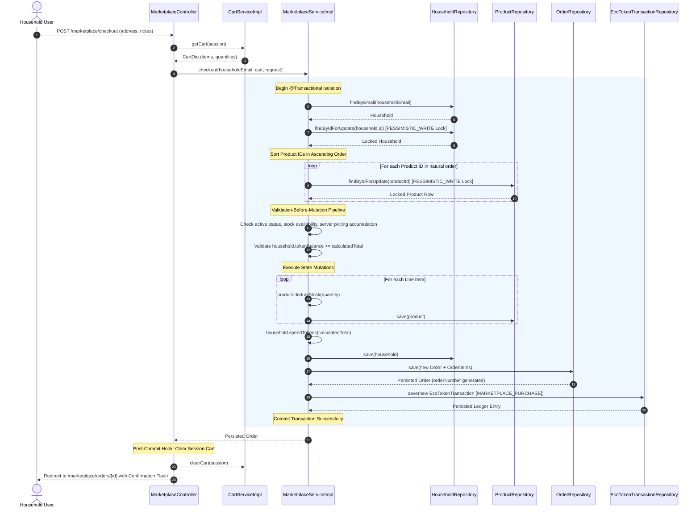

# Module 06: Sustainable Marketplace & Commerce

[← Back to Master Documentation Hub](../INDEX.md)

---

## 1. Overview & Concept

In **Phase 6: Sustainable Marketplace & Commerce**, AgroLoop completes the circular waste-to-reward-to-table economy. Farmers who collected and composted organic household waste list organic vegetables, fresh fruits, compost bags, honey, and soil amendments for sale in a community catalog. Households redeem their hard-earned **EcoTokens** to purchase these sustainable farm goods.

```text
Household Earns EcoTokens (Waste Submissions & Farmer Verification)
                           ↓
Farmer Lists Farm Produce & Compost (com.agroloop.model.Product)
                           ↓
Household Browses Catalog & Builds Session Cart (CartService / CartDto)
                           ↓
Household Submits Checkout (Delivery Address & Optional Notes)
                           ↓
Deterministic Dual-Phase Pessimistic Locking:
  1. Lock Household Row (PESSIMISTIC_WRITE)
  2. Lock Product Rows in Ascending ID Order (findByIdForUpdate)
                           ↓
Validation-Before-Mutation:
  - Product active? Stock >= requested? Household balance >= serverTotal?
                           ↓
Atomic Financial & Inventory Mutation (@Transactional):
  - Deduct Product Stock (product.deductStock)
  - Debit Household Balance (household.spendTokens)
  - Generate Order & OrderItem Historical Snapshots
  - Persist MARKETPLACE_PURCHASE EcoTokenTransaction (DB Matrix Check)
                           ↓
Transaction Successfully Committed
                           ↓
Post-Commit Hook: Clear Session Cart (Controller Boundary)
                           ↓
Redirect Household to Order Confirmation Screen
```

---

## 2. Core Invariants & Architectural Guarantees

$$\text{Successful Checkout} \iff \begin{cases}
\text{Exactly 1 } \texttt{Order} \text{ placed with status } \texttt{PLACED} \\
\text{Authoritative server-side pricing calculated strictly from live DB rows} \\
\text{Product stock deducted deterministically} \\
\text{Household token balance debited once} \\
\text{Exactly 1 } \texttt{MARKETPLACE\_PURCHASE} \text{ ledger transaction recorded} \\
\text{Session cart cleared strictly post-commit upon successful controller return}
\end{cases}$$

### 1. Deterministic Dual-Phase Locking & Concurrency Safety
* **Pessimistic Household Lock:** `householdRepository.findByIdForUpdate(household.getId())` acquires a `PESSIMISTIC_WRITE` row lock on the purchasing household, guaranteeing race-free solvency checking and balance mutation.
* **Ascending Product-ID Locks:** Product IDs are extracted and sorted in natural numerical order (`Collections.sort(productIds)`) before acquiring `productRepository.findByIdForUpdate(productId)` on each product row. This eliminates deadlock hazards when concurrent households checkout with overlapping items in different cart positions (e.g. $[A, B]$ vs $[B, A]$).
* **Deterministic Stock Contention:** Verified by `MarketplaceConcurrencyIntegrationTest`, where 10 concurrent threads attempt to purchase the last 2 units of a product simultaneously; exactly 2 checkouts succeed and 8 fail gracefully with `InsufficientStockException`.

### 2. Validation-Before-Mutation Pipeline
All state preconditions are verified **prior** to any mutation:
1. Cart is non-null and contains at least 1 item; line item quantities must be strictly $> 0$.
2. All requested products exist and have `active == true`.
3. Each product has sufficient available stock (`product.getStock() >= item.getQuantity()`).
4. Live server-side line totals and order sum are accumulated from authoritative `Product.priceInTokens` database rows (any client-submitted prices or totals in request payloads are discarded).
5. Household balance is verified to be $\ge \text{serverTotal}$.

### 3. Historical Order Integrity & Immutability
* `OrderItem` persists snapshot copies of `productName`, `unitPrice`, `unit`, `category`, and `farmerName` at the exact instant the purchase occurred.
* Subsequent changes by the farmer to product price, title, category, or farm details never alter past order receipts or transaction ledger history.
* Products participating in historical orders cannot be destructively deleted from the database. Soft archival (`active = false`) is enforced via `product.deactivate()`.

### 4. Relational & Ledger Invariant Matrix
`EcoTokenTransaction` supports both reward minting (Phase 5) and marketplace debits (Phase 6). Relational integrity is enforced at both the JPA domain and PostgreSQL database layers:
* `EcoTokenTransaction.order` is modeled as `@ManyToOne` with a database `UNIQUE(order_id)` constraint, guaranteeing that each order corresponds to at most one marketplace debit.
* Both `waste_verification_id` and `order_id` use foreign keys with `ON DELETE RESTRICT`.
* PostgreSQL check constraint `chk_ecotoken_transactions_relationship` enforces the mutual exclusivity matrix:
```sql
CONSTRAINT chk_ecotoken_transactions_relationship CHECK (
    (transaction_type = 'REWARD_MINTED' AND waste_verification_id IS NOT NULL AND order_id IS NULL)
    OR
    (transaction_type = 'MARKETPLACE_PURCHASE' AND order_id IS NOT NULL AND waste_verification_id IS NULL)
)
```

### 5. Strict Farmer Ownership Authorization
* Products can only be created, modified, activated, or deactivated by an authenticated farmer who owns that specific listing (`product.farmer.id == authenticatedFarmer.id`).
* Both service layer (`ProductServiceImpl`) and web controller layer (`FarmerProductController`) guard against cross-tenant tampering, throwing `AccessDeniedException` if a farmer attempts to manipulate another farmer's inventory.

---

## 3. Object-Oriented Principles in this Module

### Encapsulation
- **[`Product`](../../src/main/java/com/agroloop/model/Product.java):**
  - Private attributes: `name`, `description`, `category`, `unit`, `priceInTokens`, `stock`, `imageUrl`, `active`, and `@Version Long version`.
  - Public mutators enforce business invariants:
    - `deductStock(int quantity)`: Validates `quantity > 0` and `this.stock >= quantity`; throws `InsufficientStockException` on exhaustion.
    - `restock(int quantity)`: Enforces `quantity > 0` before replenishing inventory.
    - `updateDetails(...)`: Mutates mutable metadata while enforcing non-nullness and positive pricing.
    - `deactivate()` / `activate()`: Controls catalog visibility without destructive record removal.
- **[`Order`](../../src/main/java/com/agroloop/model/Order.java):**
  - Encapsulates `buyer`, `orderNumber`, `totalTokens`, `status`, `deliveryAddress`, and `orderNotes`.
  - `addItem(OrderItem item)`: Binds items to the order and synchronizes the bidirectional relationship.
  - `complete()`: Transitions order status from `PLACED` to `COMPLETED`.
  - Fallback logic: Automatically falls back to the household's registered profile address if the checkout delivery address is blank.
- **[`OrderItem`](../../src/main/java/com/agroloop/model/OrderItem.java):**
  - Encapsulates line item relationship with `Order` and references the original `Product`.
  - Stores historical immutable snapshot fields (`productName`, `unitPrice`, `unit`, `category`, `farmerName`).

### Abstraction
- **[`MarketplaceService`](../../src/main/java/com/agroloop/service/MarketplaceService.java):**
  - Declares the high-level transactional boundary for catalog checkout, order lookup, and customer order history.
- **[`ProductService`](../../src/main/java/com/agroloop/service/ProductService.java):**
  - Isolates catalog search, category filtering, farmer inventory management, and soft-delete lifecycle operations.
- **[`CartService`](../../src/main/java/com/agroloop/service/CartService.java):**
  - Abstracts HTTP session storage for shopping carts (`CartDto` and `CartItemDto`), isolating session cart lifecycle from the persistent database engine.

---

## 4. System Architecture & Sequence Flow



---

## 5. Database Constraints & Schema Invariants

Defined in Flyway migration [`V6__create_marketplace_tables.sql`](../../src/main/resources/db/migration/V6__create_marketplace_tables.sql):

| Table | Constraint Name | Type | Invariant Enforced |
| :--- | :--- | :--- | :--- |
| `products` | `pk_products` | `PRIMARY KEY` | Unique product identifier (`BIGSERIAL`). |
| `products` | `fk_products_farmer` | `FOREIGN KEY` | `farmer_id` references `farmers(id)` (`ON DELETE CASCADE`). |
| `products` | `chk_products_price` | `CHECK` | `CHECK (price_in_tokens > 0)` |
| `products` | `chk_products_stock` | `CHECK` | `CHECK (stock >= 0)` |
| `orders` | `pk_orders` | `PRIMARY KEY` | Unique order identifier (`BIGSERIAL`). |
| `orders` | `fk_orders_household` | `FOREIGN KEY` | `household_id` references `households(id)` (`ON DELETE RESTRICT`). |
| `orders` | `uq_orders_order_number` | `UNIQUE` | Human-readable order code (e.g. `ORD-20260919-XXXX`). |
| `orders` | `chk_orders_total` | `CHECK` | `CHECK (total_tokens > 0)` |
| `order_items` | `pk_order_items` | `PRIMARY KEY` | Unique order item identifier (`BIGSERIAL`). |
| `order_items` | `fk_order_items_order` | `FOREIGN KEY` | `order_id` references `orders(id)` (`ON DELETE CASCADE`). |
| `order_items` | `fk_order_items_product` | `FOREIGN KEY` | `product_id` references `products(id)` (`ON DELETE RESTRICT`). |
| `order_items` | `chk_order_items_quantity` | `CHECK` | `CHECK (quantity > 0)` |
| `order_items` | `chk_order_items_price` | `CHECK` | `CHECK (unit_price > 0)` |
| `ecotoken_transactions` | `fk_ecotoken_transactions_order` | `FOREIGN KEY` | `order_id` references `orders(id)` (`ON DELETE RESTRICT`). |
| `ecotoken_transactions` | `uq_ecotoken_transactions_order` | `UNIQUE` | Exactly one marketplace debit transaction per `order_id`. |
| `ecotoken_transactions` | `chk_ecotoken_transactions_relationship` | `CHECK` | Mutual exclusivity check: `REWARD_MINTED` requires verification; `MARKETPLACE_PURCHASE` requires order. |

---

## 6. Master Clickable File Structure & Catalog

| File Path | Layer | Key Classes / Interfaces | Core Responsibilities |
| :--- | :--- | :--- | :--- |
| [`V6__create_marketplace_tables.sql`](../../src/main/resources/db/migration/V6__create_marketplace_tables.sql) | Flyway Migration | SQL DDL | Creates `products`, `orders`, `order_items`, alters `ecotoken_transactions` with `order_id` and relationship check constraint. |
| [`ProductCategory.java`](../../src/main/java/com/agroloop/model/ProductCategory.java) | Domain Model | `ProductCategory` | Enum defining catalog categories (`ORGANIC_VEGETABLES`, `FRESH_FRUITS`, `COMPOST_AND_SOIL`, etc.). |
| [`Product.java`](../../src/main/java/com/agroloop/model/Product.java) | Domain Model | `Product` | Encapsulated entity managing stock deductions, restock, pricing, soft archival, and `@Version` optimistic locking. |
| [`OrderStatus.java`](../../src/main/java/com/agroloop/model/OrderStatus.java) | Domain Model | `OrderStatus` | Lifecycle states for orders (`PLACED`, `COMPLETED`). |
| [`Order.java`](../../src/main/java/com/agroloop/model/Order.java) | Domain Model | `Order` | Order aggregate root with line items, total tokens, buyer relationship, and profile address fallback. |
| [`OrderItem.java`](../../src/main/java/com/agroloop/model/OrderItem.java) | Domain Model | `OrderItem` | Historical snapshot line item preserving product title, unit price, category, unit, and farmer name. |
| [`EcoTokenTransaction.java`](../../src/main/java/com/agroloop/model/EcoTokenTransaction.java) | Domain Model | `EcoTokenTransaction` | Updated with `@ManyToOne` order reference and mutual exclusivity domain constructor assertions. |
| [`InsufficientStockException.java`](../../src/main/java/com/agroloop/exception/InsufficientStockException.java) | Exception | `InsufficientStockException` | Thrown when requested purchase quantity exceeds available product inventory. |
| [`InsufficientTokensException.java`](../../src/main/java/com/agroloop/exception/InsufficientTokensException.java) | Exception | `InsufficientTokensException` | Thrown when household token balance is less than authoritative server-side checkout total. |
| [`ProductRepository.java`](../../src/main/java/com/agroloop/repository/ProductRepository.java) | Repository | `ProductRepository` | Includes `findByIdForUpdate` (`PESSIMISTIC_WRITE`), active listing queries, and farmer listing queries. |
| [`OrderRepository.java`](../../src/main/java/com/agroloop/repository/OrderRepository.java) | Repository | `OrderRepository` | Queries orders by buyer, order number, and farmer line-item relationships. |
| [`OrderItemRepository.java`](../../src/main/java/com/agroloop/repository/OrderItemRepository.java) | Repository | `OrderItemRepository` | Persists and retrieves order item entities. |
| [`ProductFormRequest.java`](../../src/main/java/com/agroloop/dto/ProductFormRequest.java) | DTO | `ProductFormRequest` | Validates farmer product create/edit form inputs (`@NotBlank`, `@Positive`, `@Min(0)`). |
| [`CartItemDto.java`](../../src/main/java/com/agroloop/dto/CartItemDto.java) | DTO | `CartItemDto` | Represents a line item in the shopping cart with strictly positive quantity. |
| [`CartDto.java`](../../src/main/java/com/agroloop/dto/CartDto.java) | DTO | `CartDto` | Represents the in-session shopping cart with item count and token total calculation helpers. |
| [`CheckoutRequest.java`](../../src/main/java/com/agroloop/dto/CheckoutRequest.java) | DTO | `CheckoutRequest` | Captures delivery address and optional order instructions from the buyer. |
| [`ProductService.java`](../../src/main/java/com/agroloop/service/ProductService.java) | Service Interface | `ProductService` | Product catalog querying, creation, updating, and soft archival. |
| [`ProductServiceImpl.java`](../../src/main/java/com/agroloop/service/ProductServiceImpl.java) | Service Implementation | `ProductServiceImpl` | Enforces farmer ownership checks, positive stock checks, and catalog filtering. |
| [`CartService.java`](../../src/main/java/com/agroloop/service/CartService.java) | Service Interface | `CartService` | Session cart contract for adding, updating, removing, and clearing items. |
| [`CartServiceImpl.java`](../../src/main/java/com/agroloop/service/CartServiceImpl.java) | Service Implementation | `CartServiceImpl` | HTTP session-backed implementation managing cart state. |
| [`MarketplaceService.java`](../../src/main/java/com/agroloop/service/MarketplaceService.java) | Service Interface | `MarketplaceService` | Checkout orchestration and order retrieval contract. |
| [`MarketplaceServiceImpl.java`](../../src/main/java/com/agroloop/service/MarketplaceServiceImpl.java) | Service Implementation | `MarketplaceServiceImpl` | Deterministic dual-phase pessimistic locking, validation-before-mutation, atomic stock/token/order/ledger execution. |
| [`MarketplaceController.java`](../../src/main/java/com/agroloop/controller/MarketplaceController.java) | Web Controller | `MarketplaceController` | Public catalog browsing, cart operations, checkout processing, and order view routing with post-commit cart clearing. |
| [`FarmerProductController.java`](../../src/main/java/com/agroloop/controller/FarmerProductController.java) | Web Controller | `FarmerProductController` | Farmer product management, new/edit forms, active/archive toggles, and sales order view. |
| [`SecurityConfig.java`](../../src/main/java/com/agroloop/config/SecurityConfig.java) | Security | `SecurityConfig` | Configured route access for `/marketplace/**` and `/farmer/products/**`. |
| [`marketplace/index.html`](../../src/main/resources/templates/marketplace/index.html) | UI View | Thymeleaf View | Public catalog with category filtering, search, cards, stock badges, and add-to-cart buttons. |
| [`marketplace/details.html`](../../src/main/resources/templates/marketplace/details.html) | UI View | Thymeleaf View | Detailed product view with farmer credentials and quantity selector. |
| [`marketplace/cart.html`](../../src/main/resources/templates/marketplace/cart.html) | UI View | Thymeleaf View | Interactive cart view with quantity adjustment, item removal, and subtotal calculation. |
| [`marketplace/checkout.html`](../../src/main/resources/templates/marketplace/checkout.html) | UI View | Thymeleaf View | Checkout review screen showing balance comparison, delivery address input, and place order button. |
| [`marketplace/orders.html`](../../src/main/resources/templates/marketplace/orders.html) | UI View | Thymeleaf View | Household order history list with order numbers, timestamps, total tokens, and status badges. |
| [`marketplace/order_details.html`](../../src/main/resources/templates/marketplace/order_details.html) | UI View | Thymeleaf View | Detailed order receipt displaying frozen snapshot items, unit prices, and delivery details. |
| [`farmer/products.html`](../../src/main/resources/templates/farmer/products.html) | UI View | Thymeleaf View | Farmer inventory dashboard displaying active/archived listings and stock management controls. |
| [`farmer/product_form.html`](../../src/main/resources/templates/farmer/product_form.html) | UI View | Thymeleaf View | Create and edit product form with category dropdown, unit input, and price/stock validation. |
| [`farmer/orders.html`](../../src/main/resources/templates/farmer/orders.html) | UI View | Thymeleaf View | Farmer sales order queue showing purchases containing goods from the authenticated farmer. |

---

## 7. Test Matrix & Verification

61 automated tests specifically validate Phase 6 features across unit, concurrency, transactional rollback, and web controller integration layers:

| Test Class | Scope / Layer | Key Scenarios Validated |
| :--- | :--- | :--- |
| [`ProductModelTest`](../../src/test/java/com/agroloop/model/ProductModelTest.java) | Domain Model Unit Tests | Stock deduction, restock, negative quantity prevention, insufficient stock exception, metadata update, and activation/deactivation toggling. |
| [`OrderModelTest`](../../src/test/java/com/agroloop/model/OrderModelTest.java) | Domain Model Unit Tests | Line item accumulation, total recalculation, profile address fallback, order status completion, and historical snapshot integrity. |
| [`EcoTokenTransactionTest`](../../src/test/java/com/agroloop/model/EcoTokenTransactionTest.java) | Domain Model Unit Tests | Phase 6 constructor assertions, mutual exclusivity check (`REWARD_MINTED` vs `MARKETPLACE_PURCHASE`), scale normalization, and non-negative balance checks. |
| [`CartServiceTest`](../../src/test/java/com/agroloop/service/CartServiceTest.java) | Unit Tests | Adding items, incrementing existing quantities, updating quantities, removing items, non-positive quantity guards, and session cart clearing. |
| [`ProductServiceTest`](../../src/test/java/com/agroloop/service/ProductServiceTest.java) | Service Layer Unit Tests | Creating products, finding active products, category filtering, farmer ownership verification, unauthorized update/deactivation rejection, and soft archival. |
| [`MarketplaceServiceTest`](../../src/test/java/com/agroloop/service/MarketplaceServiceTest.java) | Service Layer Unit Tests | Successful atomic checkout, authoritative DB pricing overriding client total, insufficient stock rejection, insufficient token rejection, empty cart guard, inactive product rejection, and lock ordering. |
| [`MarketplaceConcurrencyIntegrationTest`](../../src/test/java/com/agroloop/service/MarketplaceConcurrencyIntegrationTest.java) | Concurrency Integration (`@SpringBootTest`, Real DB Locks) | 10 concurrent household checkout threads competing for the last 2 units of stock: exactly 2 succeed, exactly 8 fail with `InsufficientStockException`, stock decrements to exactly 0, and exactly 2 orders and ledger debits are persisted. |
| [`MarketplaceDeadlockAndRollbackIntegrationTest`](../../src/test/java/com/agroloop/service/MarketplaceDeadlockAndRollbackIntegrationTest.java) | Concurrency & Atomicity Integration (`@SpringBootTest`) | Deadlock avoidance with opposite cart orderings $[A, B]$ and $[B, A]$ executing concurrently; Atomic transaction rollback on solvency failure verifying zero partial mutations to stock, balance, or orders. |
| [`MarketplaceControllerTest`](../../src/test/java/com/agroloop/controller/MarketplaceControllerTest.java) | Web MVC Integration (`MockMvc`) | Catalog browsing, adding to cart, cart view, checkout page rendering, successful checkout flow with post-commit cart clearing assertion, order history, and order details receipt. |
| [`FarmerProductControllerTest`](../../src/test/java/com/agroloop/controller/FarmerProductControllerTest.java) | Web MVC Integration (`MockMvc`) | Farmer inventory listing, creating product, updating product, unauthorized cross-farmer editing forbidden (403), role protection, and toggling active status. |

---

[← Back to Master Documentation Hub](../INDEX.md)
