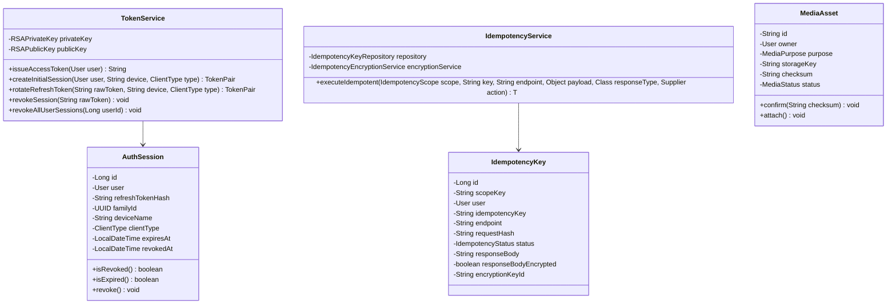

# Module 7.5: Client/API Boundary & Multi-Platform Contract Architecture

[← Back to Master Documentation Hub](../INDEX.md)

---

## 1. Overview & Concept

In **Phase 7.5: Client/API Boundary & Multi-Platform Contract Architecture**, AgroLoop introduces a dedicated, versioned `/api/v1` REST contract layer engineered to serve three modern clients:
1. **Next.js Web Frontend** (Consumer browser marketplace & portal)
2. **React Native / Expo Mobile App** (Household camera submissions & farmer QR verification)
3. **Tauri Operations Desktop Client** (Administrator auditing & solvency verification)

The existing domain entities, application services, transactional boundaries, concurrency controls, refund engine, ledger invariants, and reconciliation logic established in Phases 1–7 remain the **single authoritative source of business truth**. Phase 7.5 is strictly an **API boundary phase**; controllers do not duplicate domain rules or leak raw JPA entities.

```text
                                 Client Request
                                       │
                  ┌────────────────────┴────────────────────┐
                  │                                         │
        Web Request (/**)                       API Request (/api/v1/**)
                  │                                         │
                  ▼                                         ▼
         SecurityFilterChain @Order(2)             SecurityFilterChain @Order(1)
         SessionCreation: ALWAYS                   SessionCreation: STATELESS
         CSRF: ENABLED                             CSRF: DISABLED
         DaoAuthenticationProvider                 OAuth2 Resource Server (RSA-2048 JWT)
         Form Login & Thymeleaf                    RequestIdFilter (X-Request-Id)
                                                   AuthenticationRateLimiter
                                                   RFC 7807 RestExceptionHandler
                                                            │
                                                            ▼
                                                Dedicated REST Controllers
                                                (com.agroloop.controller.api.v1)
                                                            │
                                                DTO Projections Only
                                                (com.agroloop.dto.api.v1.response)
                                                            │
                                                            ▼
                                                Authoritative Domain Services
                                                (MarketplaceService, AdminGovService, ...)
```

---

## 2. Core Invariants & Architectural Guarantees

$$\text{API Security & Idempotency Guarantee} \iff \begin{cases}
\text{Stateless Bearer JWT: } \text{Valid RSA-2048 signature, } \text{expiry } \le 15\text{m}, \text{ unforgeable roles} \\
\text{Refresh Rotation: } \text{Pessimistic lock on session}, \text{ family revocation on replay breach} \\
\text{Client Delivery: } \begin{cases} \text{Web: HttpOnly cookie, zero tokens in JSON} \\ \text{Native: Refresh token in JSON payload} \end{cases} \\
\text{Idempotency Scope: } \begin{cases} \text{Authenticated: } \texttt{user:<userId>} \\ \text{Refresh: } \texttt{refresh:<sha256(refreshToken)>} \end{cases} \\
\text{Response Encryption: } \text{RefreshScope cached responses encrypted at rest via AES-GCM-256} \\
\text{Zero Entity Leakage: } \forall e \in \text{Entities}, \;\; e \notin \text{Controller Return Signatures}
\end{cases}$$

### 1. Dual Spring Security Filter Chains
- **`@Order(1)` Stateless REST Chain (`/api/v1/**`)**:
  - Configured with `SessionCreationPolicy.STATELESS` and disabled CSRF.
  - JWT Bearer validation verified via public RSA-2048 key (`NimbusJwtDecoder`).
  - Request correlation IDs injected at the entrypoint via `RequestIdFilter`.
  - Rate limiting enforced on authentication endpoints (`AuthenticationRateLimiter`).
  - RFC 7807 Problem Details error responses for 401 Unauthorized, 403 Forbidden, and all exceptions via `RestExceptionHandler`.
- **`@Order(2)` Session-Based Web Chain (`/**`)**:
  - Retains form login, server-side session management, and CSRF tokens for existing Thymeleaf portal views.

### 2. Enterprise Session Management & Token Family Rotation
- **Access Tokens**: Short-lived (15 minutes), signed with an in-memory or configured RSA-2048 private key.
- **Refresh Tokens**: 64 cryptographically random bytes, SHA-256 hashed prior to storage in the `auth_sessions` table.
- **Race-Safe Rotation**: `TokenService.rotateRefreshToken()` acquires a `PESSIMISTIC_WRITE` lock on the active `AuthSession`.
- **Breach Detection & Family Invalidation**: If an already revoked or rotated session is presented with a new idempotency key, the entire UUID `family_id` is immediately revoked across all devices.

### 3. Concurrency-Safe Idempotency Engine
- Mutations requiring idempotency accept an `Idempotency-Key` header.
- Scoped uniqueness prevents cross-user key collisions:
  - Authenticated: `scope_key = user:<userId>`
  - Refresh rotation: `scope_key = refresh:<sha256(refreshToken)>`
- In-flight duplicate requests are detected under lock and return HTTP `409 Conflict`.
- `RefreshScope` responses are automatically encrypted at rest using `AES-GCM-256` so that raw refresh tokens are never persisted in plaintext.

### 4. Zero JPA Entity Leakage
All REST controllers in `com.agroloop.controller.api.v1` project strictly through immutable Java record DTOs:
- `OrderApiResponse` (with line item snapshots)
- `ProductApiResponse`
- `HouseholdBalanceResponse`
- `WasteSubmissionApiResponse`
- `PickupRequestApiResponse`
- `PlatformSolvencyApiResponse`

---

## 3. Class Diagram & Architecture



---

## 4. Master File Catalog

| File Path | Responsibility |
| :--- | :--- |
| **[`SecurityConfig.java`](../../src/main/java/com/agroloop/config/SecurityConfig.java)** | Dual filter chains: `@Order(1)` stateless OAuth2 Resource Server and `@Order(2)` web session chain. |
| **[`TokenService.java`](../../src/main/java/com/agroloop/security/TokenService.java)** | RSA-2048 signing, SHA-256 refresh hashing, pessimistic rotation, and token family invalidation. |
| **[`IdempotencyService.java`](../../src/main/java/com/agroloop/security/IdempotencyService.java)** | Concurrency-safe idempotency coordinator with scoped uniqueness and transaction isolation. |
| **[`IdempotencyEncryptionService.java`](../../src/main/java/com/agroloop/security/IdempotencyEncryptionService.java)** | AES-GCM-256 payload encryption at rest for refresh token idempotency responses. |
| **[`RequestIdFilter.java`](../../src/main/java/com/agroloop/security/RequestIdFilter.java)** | Filter injecting `X-Request-Id` correlation IDs into requests and responses. |
| **[`AuthenticationRateLimiter.java`](../../src/main/java/com/agroloop/security/AuthenticationRateLimiter.java)** | Sliding-window brute force protection on auth endpoints. |
| **[`RestExceptionHandler.java`](../../src/main/java/com/agroloop/security/RestExceptionHandler.java)** | RFC 7807 Problem Details exception handler for all API errors. |
| **[`AuthApiController.java`](../../src/main/java/com/agroloop/controller/api/v1/AuthApiController.java)** | REST controller: `/api/v1/auth/login`, `/register`, `/refresh`, `/logout`, `/logout-all`, `/me`. |
| **[`MarketplaceApiController.java`](../../src/main/java/com/agroloop/controller/api/v1/MarketplaceApiController.java)** | REST controller: `/api/v1/marketplace/products`, `/products/{id}`, `/categories`. |
| **[`OrderApiController.java`](../../src/main/java/com/agroloop/controller/api/v1/OrderApiController.java)** | REST controller: `/api/v1/orders/**` with `@orderAuth` IDOR protection. |
| **[`HouseholdApiController.java`](../../src/main/java/com/agroloop/controller/api/v1/HouseholdApiController.java)** | REST controller: `/api/v1/household/balance`, `/ledger`, `/waste-submissions`. |
| **[`PickupApiController.java`](../../src/main/java/com/agroloop/controller/api/v1/PickupApiController.java)** | REST controller: `/api/v1/pickups/**` with `@pickupAuth` IDOR protection. |
| **[`FarmerApiController.java`](../../src/main/java/com/agroloop/controller/api/v1/FarmerApiController.java)** | REST controller: `/api/v1/farmer/pickups/available`, `/claim`, `/schedule`, `/collect`, `/verify`, `/products`, `/orders`. |
| **[`AdminApiController.java`](../../src/main/java/com/agroloop/controller/api/v1/AdminApiController.java)** | REST controller: `/api/v1/admin/solvency`, `/ledger`, `/orders`, `/users`. |
| **[`MediaApiController.java`](../../src/main/java/com/agroloop/controller/api/v1/MediaApiController.java)** | REST controller: Two-phase `/upload-ticket`, upload, confirm, download. |
| **[`OpenApiConfig.java`](../../src/main/java/com/agroloop/config/OpenApiConfig.java)** | OpenAPI 3.1 configuration with BearerAuth security scheme. |
| **[`V8__api_sessions_idempotency_media.sql`](../../src/main/resources/db/migration/V8__api_sessions_idempotency_media.sql)** | Flyway migration for `auth_sessions`, `idempotency_keys`, and `media_assets`. |

---

## 5. Verification & Test Coverage

Phase 7.5 was verified against a total of **265 tests (100% green)**:
- **`AuthApiControllerTest`** (9 tests): Login for Web vs Native, token rotation, token family revocation upon replay, logout, `/me`.
- **`RefreshConcurrencyTest`** (1 test): Thread contention on refresh rotation; exactly one succeeds and invalidates the session.
- **`IdempotencyIntegrationTest`** (3 tests): Cached response replay, 409 in-flight duplicate conflict, AES-GCM-256 encrypted at-rest refresh response.
- **`ApiAuthorizationTest`** (10 tests): Public access, 401 unauthenticated, 403 cross-role protection, IDOR prevention on orders and pickups.
- **`OpenApiContractTest`** (1 test): OpenAPI 3.1 spec generation and BearerAuth schema validation.
- **Phases 1–7 Regression Suite** (241 tests): 100% passing without regressions.
