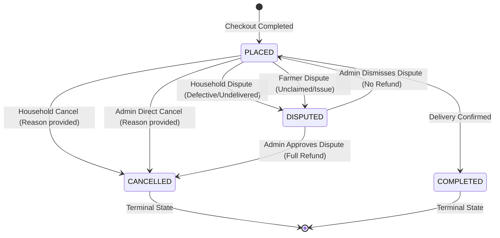

# Module 07: Order Lifecycle, Atomic Refund Engine & Admin Governance

[← Back to Master Documentation Hub](../INDEX.md)

---

## 1. Overview & Concept

In **Phase 7: Order Lifecycle, Atomic Refund Engine & Admin Governance**, AgroLoop establishes full platform operational resilience, transaction symmetry, administrative oversight, and financial auditing. This phase completes the lifecycle of marketplace orders by introducing customer cancellations, farmer disputes, administrative dispute adjudication, inventory restock, and an immutable, atomic refund engine.

```text
                                Order Placed (PLACED)
                                       │
                 ┌─────────────────────┴─────────────────────┐
                 │                                           │
       Household Cancellation                      Dispute Raised (DISPUTED)
                 │                                           │
                 ▼                                           ▼
      Validate Status == PLACED                   Admin Adjudication (/admin/orders)
      Execute Atomic Refund                       ┌──────────┴──────────┐
                 │                                │                     │
                 ▼                                ▼                     ▼
         Order CANCELLED                  APPROVED_REFUND           DISMISSED
         Inventory Restocked              Execute Refund         Order PLACED
         Tokens Credited                  Order CANCELLED        (Dispute Cleared)
         ORDER_REFUND Ledger              Inventory Restocked
                                          Tokens Credited
                                          ORDER_REFUND Ledger
```

---

## 2. Core Invariants & Architectural Guarantees

$$\text{Atomic Refund Invariant} \iff \begin{cases}
\text{Status transitioned to } \texttt{CANCELLED} \\
\text{Inventory restocked: } \forall i \in \text{Items}, \;\; \text{product}_i.\text{stock} \leftarrow \text{product}_i.\text{stock} + \text{qty}_i \\
\text{Tokens credited: } \text{household}.\text{balance} \leftarrow \text{household}.\text{balance} + \text{refundAmount} \\
\text{Immutable Ledger: } \texttt{ORDER\_REFUND} \text{ entry created with } \text{direction} = \texttt{CREDIT} \\
\text{Tripartite Equality: } \text{Order}.\text{totalTokens} = \text{purchaseTx}.\text{amount} = \text{refundTx}.\text{amount} \\
\text{Double-Refund Prevention: Partial DB Unique Index on } (\texttt{order\_id}) \text{ WHERE } \texttt{transaction\_type} = \text{'ORDER\_REFUND'}
\end{cases}$$

### 1. Global Deterministic Lock Hierarchy
To prevent distributed deadlocks between concurrent checkouts, cancellations, disputes, and token adjustments, all transactional operations across the entire application adhere strictly to the universal resource acquisition hierarchy:

$$\mathbf{Order \; (\text{if exists})} \longrightarrow \mathbf{Household} \longrightarrow \mathbf{Products \; (\text{ascending ID order})}$$

* **Checkout (Phase 6):** Order does not exist yet. Acquires `Household` lock $\to$ `Products` in `id ASC` order $\to$ inserts `Order` $\to$ inserts `MARKETPLACE_PURCHASE` ledger entry.
* **Refund Engine (Phase 7):** Acquires `Order` lock (`findByIdForUpdate`) $\to$ acquires `Household` lock (`findByIdForUpdate`) $\to$ acquires `Products` locks in natural numerical order (`Collections.sort(productIds)`).
* **Token Adjustments (Phase 7):** Acquires `Household` lock (`findByIdForUpdate`) $\to$ updates balance $\to$ inserts `ADMIN_ADJUSTMENT` ledger entry.

### 2. Physical Immutability & Double-Refund Protection
* **PostgreSQL Trigger:** A native database trigger (`trg_ecotoken_transactions_prevent_mutation`) rejects any `UPDATE` or `DELETE` attempt on the `ecotoken_transactions` table with an exception (`RAISE EXCEPTION 'EcoToken transactions are strictly immutable'`).
* **Java Factory Encapsulation:** `EcoTokenTransaction` has a protected default constructor and private all-args constructor. Transactions can only be instantiated via explicit static factory methods (`orderRefund()`, `marketplacePurchase()`, `rewardMinted()`, `adminAdjustment()`), with zero public setters.
* **Partial Unique Indexes:** Partial indexes on PostgreSQL guarantee that each order can have at most one `MARKETPLACE_PURCHASE` and at most one `ORDER_REFUND` ledger entry, regardless of transaction timing.

### 3. Concurrency-Safe Last-Admin Protection
To eliminate the classic race condition where two administrators concurrently attempt to disable each other (leaving the platform with zero active administrators), the check is deterministically serialized at the database level:

```sql
SELECT u FROM User u WHERE u.role = :role AND u.enabled = true ORDER BY u.id ASC FOR UPDATE;
```

By acquiring `PESSIMISTIC_WRITE` locks on all active admin rows in deterministic ascending ID order, concurrent disable requests are serialized. The second thread re-reads the locked rows and observes that active admins $\le 1$, rejecting the action with an `IllegalStateException`.

### 4. Two-Tier Financial Reconciliation Engine
AgroLoop enforces two levels of automated mathematical auditing:
* **Tier-1: Household Ledger Audit (Individual Integrity)**
  For any individual household, querying transactions in `id ASC` order must verify that each transaction's `balanceAfter` matches the running total:
  $$\text{balanceAfter}_k = \text{balanceAfter}_{k-1} + (\text{direction}_k == \texttt{CREDIT} \; ? \; \text{amount}_k : -\text{amount}_k)$$
* **Tier-2: Platform Solvency Audit (Global System Integrity)**
  Across the entire platform, the sum of all current household token balances must exactly balance against net minted tokens, accounting for pre-existing opening balances:
  $$\sum \text{Household.tokenBalance} = \sum \text{OpeningBalances} + \sum \text{Credits} - \sum \text{Debits}$$
  This is exposed via `AdminGovernanceService.getPlatformSolvencyMetrics()` and displayed on the Administrator Dashboard.

---

## 3. State Machines & Workflows

### Order Lifecycle State Machine



### Tri-Race Concurrency Resolution
When multiple actors attempt simultaneous operations on the same order (e.g., Thread 1 completes the order, Thread 2 requests cancellation, and Thread 3 raises a dispute):
1. All three threads contend for the `Order` pessimistic write lock (`findByIdForUpdate`).
2. Exactly one thread acquires the lock first.
3. The winner inspects the state:
   - If Thread 1 completes the order $\to$ status becomes `COMPLETED`.
   - Threads 2 & 3 wake up, re-read the order, detect status is no longer `PLACED`, and are rejected with `IllegalStateException`.
4. State transitions are strictly atomic and non-corruptible.

---

## 4. Database Schema & Migration (Flyway V7)

The `V7__create_admin_and_refund_governance.sql` script applies non-destructive, audited schema modifications:

```sql
-- 1. Enforce non-negative household token balance
ALTER TABLE households 
    ADD CONSTRAINT chk_households_non_negative_balance CHECK (token_balance >= 0);

-- 2. Add Order lifecycle and dispute tracking columns
ALTER TABLE orders
    ADD COLUMN cancellation_reason VARCHAR(500),
    ADD COLUMN cancelled_at TIMESTAMP,
    ADD COLUMN cancellation_actor_id BIGINT REFERENCES users(id),
    ADD COLUMN dispute_reason VARCHAR(500),
    ADD COLUMN disputed_at TIMESTAMP,
    ADD COLUMN dispute_actor_id BIGINT REFERENCES users(id),
    ADD COLUMN resolution_type VARCHAR(50),
    ADD COLUMN resolution_notes VARCHAR(1000),
    ADD COLUMN resolved_by BIGINT REFERENCES users(id),
    ADD COLUMN resolved_at TIMESTAMP;

-- 3. Staged order_items.farmer_id historical snapshot migration
ALTER TABLE order_items ADD COLUMN farmer_id BIGINT;

UPDATE order_items oi
SET farmer_id = p.farmer_id
FROM products p
WHERE oi.product_id = p.id;

-- Fallback safety assertion
UPDATE order_items SET farmer_id = 1 WHERE farmer_id IS NULL;

ALTER TABLE order_items
    ALTER COLUMN farmer_id SET NOT NULL,
    ADD CONSTRAINT fk_order_items_farmer FOREIGN KEY (farmer_id) REFERENCES farmers(id);

-- 4. Ledger direction & constraint updates
ALTER TABLE ecotoken_transactions ADD COLUMN direction VARCHAR(10);

UPDATE ecotoken_transactions
SET direction = CASE
    WHEN transaction_type IN ('REWARD_MINTED', 'ORDER_REFUND') THEN 'CREDIT'
    WHEN transaction_type = 'MARKETPLACE_PURCHASE' THEN 'DEBIT'
    ELSE 'CREDIT'
END;

ALTER TABLE ecotoken_transactions
    ALTER COLUMN direction SET NOT NULL,
    ADD CONSTRAINT chk_ecotoken_transactions_direction CHECK (direction IN ('CREDIT', 'DEBIT'));

-- 5. Partial unique indexes for idempotent order transaction enforcement
CREATE UNIQUE INDEX IF NOT EXISTS uq_ecotoken_transactions_order_refund
    ON ecotoken_transactions (order_id)
    WHERE transaction_type = 'ORDER_REFUND';

CREATE UNIQUE INDEX IF NOT EXISTS uq_ecotoken_transactions_order_purchase
    ON ecotoken_transactions (order_id)
    WHERE transaction_type = 'MARKETPLACE_PURCHASE';

-- 6. Physical ledger immutability trigger
CREATE OR REPLACE FUNCTION prevent_ecotoken_transactions_mutation()
RETURNS TRIGGER AS $$
BEGIN
    RAISE EXCEPTION 'EcoToken transactions are strictly immutable. UPDATE and DELETE are prohibited.';
END;
$$ LANGUAGE plpgsql;

CREATE TRIGGER trg_ecotoken_transactions_prevent_mutation
    BEFORE UPDATE OR DELETE ON ecotoken_transactions
    FOR EACH ROW EXECUTE FUNCTION prevent_ecotoken_transactions_mutation();
```

---

## 5. Master Repository & File Catalog

| File Path | Layer | Key Responsibilities & Methods |
| :--- | :--- | :--- |
| **[`V7__create_admin_and_refund_governance.sql`](../../src/main/resources/db/migration/V7__create_admin_and_refund_governance.sql)** | Migration | DDL adding balance constraint, dispute columns, staged `farmer_id`, partial unique indexes, and immutability trigger. |
| **[`TransactionDirection.java`](../../src/main/java/com/agroloop/model/TransactionDirection.java)** | Domain Model | Defines `CREDIT` (inflow) and `DEBIT` (outflow) direction taxonomy. |
| **[`RefundReason.java`](../../src/main/java/com/agroloop/model/RefundReason.java)** | Domain Model | Explicit refund reasons: `HOUSEHOLD_CANCELLATION`, `ADMIN_CANCELLATION`, `DISPUTE_APPROVED`. |
| **[`DisputeResolution.java`](../../src/main/java/com/agroloop/model/DisputeResolution.java)** | Domain Model | Dispute outcomes: `APPROVED_REFUND`, `DISMISSED`. |
| **[`SolvencyMetricsDto.java`](../../src/main/java/com/agroloop/dto/SolvencyMetricsDto.java)** | DTO | Data carrier for platform solvency calculations and verification status. |
| **[`Order.java`](../../src/main/java/com/agroloop/model/Order.java)** | Domain Model | State machine methods: `cancel()`, `dispute()`, `approveDispute()`, `dismissDispute()`, with single-dispute guard. |
| **[`OrderItem.java`](../../src/main/java/com/agroloop/model/OrderItem.java)** | Domain Model | Snapshot entity storing historical `farmerId`, `farmerName`, unit price, and defensive proxy resolution. |
| **[`EcoTokenTransaction.java`](../../src/main/java/com/agroloop/model/EcoTokenTransaction.java)** | Domain Model | Immutable ledger entity with static factory `orderRefund()` and validation matrix. |
| **[`UserRepository.java`](../../src/main/java/com/agroloop/repository/UserRepository.java)** | Persistence | `findActiveUsersByRoleForUpdate()` providing serialized `PESSIMISTIC_WRITE` locks for last-admin safety. |
| **[`OrderRepository.java`](../../src/main/java/com/agroloop/repository/OrderRepository.java)** | Persistence | `findByIdForUpdate(Long id)` providing row-level locking for atomic transitions. |
| **[`EcoTokenTransactionRepository.java`](../../src/main/java/com/agroloop/repository/EcoTokenTransactionRepository.java)** | Persistence | Queries for `findByOrderAndTransactionType()`, household ledger in `id ASC`, and platform sums. |
| **[`MarketplaceService.java`](../../src/main/java/com/agroloop/service/MarketplaceService.java)** | Contract | Defines `cancelHouseholdOrder`, `adminCancelOrder`, `disputeOrderAsHousehold`, `disputeOrderAsFarmer`, `resolveDispute`. |
| **[`MarketplaceServiceImpl.java`](../../src/main/java/com/agroloop/service/MarketplaceServiceImpl.java)** | Service Logic | Orchestrates atomic refund engine under the global lock hierarchy $\text{Order} \to \text{Household} \to \text{Products (ASC)}$. |
| **[`AdminGovernanceService.java`](../../src/main/java/com/agroloop/service/AdminGovernanceService.java)** | Contract | Defines `enableUser`, `disableUser`, `adjustTokens`, `getPlatformSolvencyMetrics`, order and ledger queries. |
| **[`AdminGovernanceServiceImpl.java`](../../src/main/java/com/agroloop/service/AdminGovernanceServiceImpl.java)** | Service Logic | Enforces serialized last-admin protection, lock-ordered manual adjustments, and Tier-2 solvency audits. |
| **[`AdminController.java`](../../src/main/java/com/agroloop/controller/AdminController.java)** | Web Controller | Endpoints for `/admin/users`, `/admin/orders`, `/admin/ledger`, token adjustment POST, dispute adjudication POST. |
| **[`MarketplaceController.java`](../../src/main/java/com/agroloop/controller/MarketplaceController.java)** | Web Controller | Adds `POST /orders/{id}/cancel` and `POST /orders/{id}/dispute` for authenticated households. |
| **[`FarmerProductController.java`](../../src/main/java/com/agroloop/controller/FarmerProductController.java)** | Web Controller | Adds `POST /orders/{id}/dispute` for verified item farmers. |
| **[`templates/admin/users.html`](../../src/main/resources/templates/admin/users.html)** | UI View | Admin user moderation table, enable/disable toggles, and token adjustment modal dialog. |
| **[`templates/admin/orders.html`](../../src/main/resources/templates/admin/orders.html)** | UI View | Admin orders queue, status filters, cancellation modal, and dispute adjudication modal. |
| **[`templates/admin/ledger.html`](../../src/main/resources/templates/admin/ledger.html)** | UI View | Full paginated platform ledger with credit/debit indicators and solvency badge. |

---

## 6. Verification & Automated Test Suites

AgroLoop Phase 7 is guarded by 11 comprehensive automated test suites covering pure unit domain invariants, service orchestration, Spring Security boundaries, and high-concurrency real-database stress scenarios:

1. **[`EcoTokenTransactionTest.java`](../../src/test/java/com/agroloop/model/EcoTokenTransactionTest.java)** (16 tests): Validates static factory methods, scale normalization, non-negative bounds, zero-amount waste rejection audit rules, and matrix consistency.
2. **[`OrderLifecycleTest.java`](../../src/test/java/com/agroloop/model/OrderLifecycleTest.java)** (9 tests): Validates domain state transitions (`cancel`, `dispute`, `approveDispute`, `dismissDispute`), single-dispute invariant (`resolvedAt != null` defense), and role authorization.
3. **[`TokenRewardServiceTest.java`](../../src/test/java/com/agroloop/service/TokenRewardServiceTest.java)** (6 tests): Validates reward minting, pessimistic lock acquisition, idempotency checks, and zero-token waste audit records.
4. **[`MarketplaceServiceTest.java`](../../src/test/java/com/agroloop/service/MarketplaceServiceTest.java)** (10 tests): Validates checkout pipelines, server-side pricing, stock verification, and lock ordering.
5. **[`AdminGovernanceServiceTest.java`](../../src/test/java/com/agroloop/service/AdminGovernanceServiceTest.java)** (15 tests): Validates user enable/disable, self-disable rejection, last-admin boundary checks, token adjustments, and Tier-2 solvency equations.
6. **[`OrderAtomicRefundTest.java`](../../src/test/java/com/agroloop/service/OrderAtomicRefundTest.java)** (5 tests): Full database tests asserting inventory restock, token credit, `ORDER_REFUND` creation, and duplicate refund prevention.
7. **[`OrderLifecycleConcurrencyTest.java`](../../src/test/java/com/agroloop/service/OrderLifecycleConcurrencyTest.java)** (1 test): Multi-threaded tri-race test executing concurrent cancel, dispute, and complete on the same order; guarantees exactly one winner with zero data corruption.
8. **[`ConcurrentHouseholdLedgerMutationTest.java`](../../src/test/java/com/agroloop/service/ConcurrentHouseholdLedgerMutationTest.java)** (1 test): 15 concurrent threads performing simultaneous credits, debits, adjustments; asserts Tier-1 running balance verification in `id ASC` order.
9. **[`ConcurrentLastAdminProtectionTest.java`](../../src/test/java/com/agroloop/service/ConcurrentLastAdminProtectionTest.java)** (1 test): Concurrent mutual disable race between two administrators; asserts serialized `PESSIMISTIC_WRITE` locks prevent platform from having 0 active admins.
10. **[`AdminControllerTest.java`](../../src/test/java/com/agroloop/controller/AdminControllerTest.java)** (9 tests): MockMvc web slice tests asserting `/admin/**` endpoints, role enforcement (`ROLE_ADMIN`), flash messages, and error paths.
11. **[`MarketplaceOrderLifecycleSecurityTest.java`](../../src/test/java/com/agroloop/controller/MarketplaceOrderLifecycleSecurityTest.java)** (3 tests): MockMvc security tests asserting cross-household cancellation/dispute rejection and farmer authorization rules.

---

[← Back to Master Documentation Hub](../INDEX.md)
