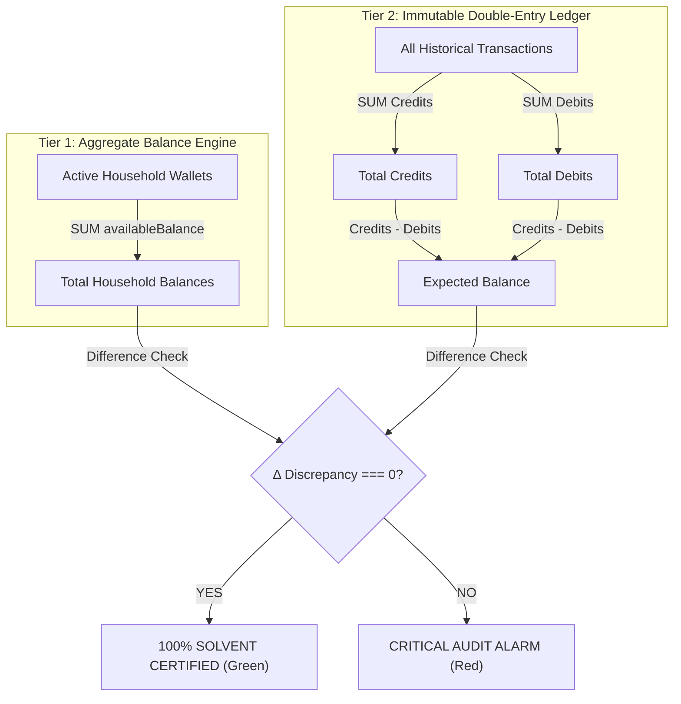
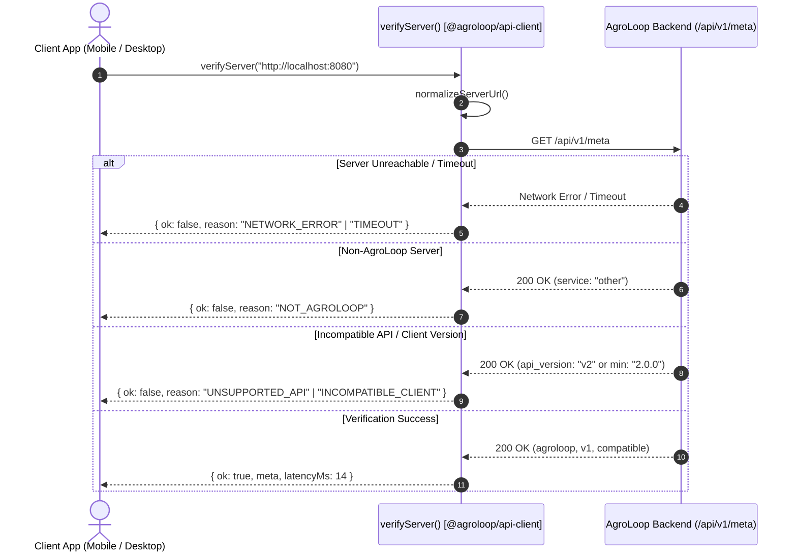

# Module 08: Cross-Platform Clients Architecture (Web Portal & Desktop Console)

[← Back to Master Documentation Hub](../INDEX.md)

---

## 1. Executive Summary & Multi-Client Topology

In **Phase 8 (Track A & Track B)**, AgroLoop delivers high-assurance, cross-platform client interfaces built strictly upon the **Phase 7.5 Client/API boundary**:

1. **Track A: Next.js 15 Web Portal (`@agroloop/web`)**:
   - Modern App Router web portal catering to Households and Farmers.
   - **Backend-For-Frontend (BFF) Security Isolation**: Browser JavaScript strictly communicates with Next.js `/api/*` route handlers. Browser code **never receives, inspects, or persists refresh tokens**.
   - **Cookie Boundary**: Refresh tokens are stored strictly as `HttpOnly; Secure; SameSite=Lax` cookies (`eco_refresh_token`) managed exclusively by Next.js route handlers.
   - **Server-Side Single-Flight Mutex**: Coalesces concurrent browser requests requiring refresh into a single upstream request to Spring Boot `/api/v1/auth/refresh`, protecting against race conditions and replay alarms in rotating refresh token families.
   - **Strict Allowlist Route Proxy**: Proxies allowed operational subpaths (`marketplace`, `orders`, `household`, `farmer`, `pickups`) while categorically rejecting unauthorized domains (e.g. `admin`) with `HTTP 403 Forbidden`.
   - **Server-Authoritative Cart & Checkout**: Persists strictly `{ productId, quantity }` locally without caching prices or balances; checkout is validated authoritatively by Spring Boot under dual-phase pessimistic database locks.

2. **Track B: Tauri v2 Desktop Operations Console (`@agroloop/desktop`)**:
   - High-performance, native operator workstation for administrators and financial auditors.
   - **OS Keychain Delegation**: Storage delegates across Tauri v2 IPC (`window.__TAURI_INTERNALS__`) into native operating system secret stores (macOS Keychain, Windows Credential Manager, Linux Secret Service). Plaintext disk storage is strictly banned.
   - **Authoritative Solvency Audit Dashboard**: Real-time reconciliation between aggregate household wallet balances (Tier 1) and system-wide immutable double-entry ledger entries (Tier 2):
     $$\text{Solvency Invariant: } \sum \text{Household Balances} = \sum \text{Credits} - \sum \text{Debits}$$
   - **User Governance & Safeguards**: Operator directory with active status toggling guarded against self-deactivation and last-admin lockout.
   - **Pessimistic Token Adjustments**: Integer-only token grants and revocations under explicit database row locks with mandatory audit justifications.
   - **Marketplace Dispute Mediation**: Atomic refund execution (`APPROVED_REFUND`) and claim dismissal (`DISMISSED`).
   - **Fleet Logistics Telemetry**: Read-only operational monitor tracking regional pickup queues, farmer claims, and on-site QR verification statuses.

3. **Shared Pure TypeScript QR Package (`@agroloop/qr`)**:
   - Zero-dependency QR Code matrix generator based on Kazuhiko Arase's algorithm.
   - Zero native binaries, zero external libraries, zero HMAC secrets.
   - Renders crisp SVG matrices on Web and Desktop.

```text
┌─────────────────────────────────────────────────────────────────────────────────────────────┐
│                                 AGROLOOP MULTI-CLIENT ECOSYSTEM                             │
└─────────────────────────────────────────────────────────────────────────────────────────────┘

       ┌───────────────────────┐                     ┌───────────────────────────┐
       │   Browser Runtime     │                     │   Tauri v2 Desktop App    │
       │   (@agroloop/web)     │                     │   (@agroloop/desktop)     │
       └───────────┬───────────┘                     └─────────────┬─────────────┘
                   │                                               │
                   │ In-Memory Access Token                        │ Bearer JWT
                   │ HttpOnly Cookie (Invisible to JS)             │ OS Keychain (IPC)
                   ▼                                               │
       ┌───────────────────────┐                                   │
       │   Next.js 15 BFF      │                                   │
       │   (/api/auth/*,       │                                   │
       │    /api/proxy/*)      │                                   │
       └───────────┬───────────┘                                   │
                   │                                               │
                   │ Server-to-Server Mutual Auth                  │
                   │ Single-Flight Refresh Mutex                   │
                   ▼                                               ▼
       ┌─────────────────────────────────────────────────────────────────────────┐
       │                 Spring Boot 3.3.4 Backend (/api/v1/*)                   │
       │                                                                         │
       │  • Stateless JWT Resource Server    • Dual-Phase Pessimistic Locks      │
       │  • Rotating Token Families          • Tier-1 & Tier-2 Solvency Engine   │
       │  • Idempotency Engine               • HMAC-SHA256 Pickup Handshake      │
       └─────────────────────────────────────────────────────────────────────────┘
```

---

## 2. Web Portal Architecture & BFF Security (`@agroloop/web`)

### 2.1 BFF Token Handling & Single-Flight Mutex Flow

The browser JavaScript runtime **never receives or manipulates the refresh token**. When logging in or refreshing tokens:

```text
Browser Client                     Next.js BFF                   Spring Boot Backend
     │                                  │                                  │
     │── POST /api/auth/login ─────────▶│                                  │
     │   { email, password }            │── POST /api/v1/auth/login ──────▶│
     │                                  │   { email, password, WEB }       │
     │                                  │                                  │
     │                                  │◀── { accessToken, refreshToken, ─│
     │                                  │      user, expiresInSeconds }    │
     │                                  │                                  │
     │                                  │ [Set-Cookie: eco_refresh_token   │
     │                                  │  HttpOnly; Secure; SameSite=Lax] │
     │                                  │                                  │
     │◀── 200 OK ───────────────────────┤                                  │
     │    { accessToken, user }         │                                  │
     │    (NO refreshToken in body)     │                                  │
```

When an in-memory access token expires, concurrent browser API calls trigger token refreshes. To prevent multiple parallel requests from each presenting the rotating refresh token (which would trigger the backend's automatic family breach invalidation):

```text
Browser Client Requests              Next.js BFF Refresh Handler         Spring Boot
  Req A ──┐                               │                                  │
  Req B ──┼── POST /api/auth/refresh ────▶│ [Single-Flight Mutex]            │
  Req C ──┘   (Cookie attached by browser)│                                  │
                                          │ ── ONE Upstream Request ────────▶│
                                          │    POST /api/v1/auth/refresh     │
                                          │                                  │
                                          │ ◀── New Token Pair ──────────────│
                                          │                                  │
                                          │ [Rotate HttpOnly Cookie]         │
  Req A ◀── All 3 Requests Resolved ──────┤                                  │
  Req B ◀── with the Single Issued ───────┤                                  │
  Req C ◀── Access Token ─────────────────┘                                  │
```

### 2.2 BFF Proxy Route Allowlist

The generic proxy handler in [`clients/web/src/app/api/proxy/[...path]/route.ts`](file:///Users/rahul/Desktop/Projects/Personal/AgroLoop/clients/web/src/app/api/proxy/%5B...path%5D/route.ts) strictly validates outbound path prefixes:

```typescript
export const ALLOWED_PROXY_PREFIXES = [
  "marketplace",
  "orders",
  "household",
  "farmer",
  "pickups",
] as const;
```

Any attempt to target unauthorized endpoints (e.g. `/api/proxy/admin/*` or `/api/proxy/internal/*`) is immediately intercepted and rejected with `HTTP 403 Forbidden` without hitting upstream Spring Boot services.

---

## 3. Desktop Operations Console Architecture (`@agroloop/desktop`)

### 3.1 OS Keychain Delegation via Tauri v2 IPC

In [`clients/desktop/src/storage/desktop-storage.ts`](file:///Users/rahul/Desktop/Projects/Personal/AgroLoop/clients/desktop/src/storage/desktop-storage.ts), credentials delegate into native OS secure storage through Tauri v2 Rust IPC handlers:

- **macOS**: Apple Keychain Services (`SecItemAdd`, `SecItemCopyMatching`)
- **Windows**: Windows Credential Manager (`CredWriteW`, `CredReadW`)
- **Linux**: Freedesktop Secret Service API via D-Bus / libsecret

When executed outside Tauri (such as during browser automated tests or dev hot reloading), it cleanly falls back to an isolated in-memory map. **Zero sensitive tokens are ever persisted to plaintext disk files or unencrypted web storage.**

### 3.2 Tier-1 & Tier-2 Solvency Reconciliation Dashboard

The desktop operator console provides authoritative verification of platform solvency, rendering the backend `SolvencyMetricsDto`:



### 3.3 Privileged Safety Guards & Pessimistic Token Adjustments

The desktop **User Governance** component enforces two non-negotiable safety guards:
1. **Self-Disable Guard**: An active operator cannot toggle their own account status to disabled.
2. **Last-Admin Guard**: When disabling an administrator, the client and server verify that at least one other active administrator remains:
   $$\text{Active Admins} > 1 \implies \text{Status update allowed}$$
3. **Integer Arithmetic**: Token adjustments only accept positive whole integers. Floating-point fractions are rejected client-side and bounded by backend `TokenAdjustmentApiRequest`.

---

## 4. Clickable Repository File Tree

```
AgroLoop/
├── clients/
│   ├── packages/
│   │   ├── api-types/
│   │   │   └── src/generated/schema.ts ............................. [OpenAPI 3.1 Generated Schema Definitions](file:///Users/rahul/Desktop/Projects/Personal/AgroLoop/clients/packages/api-types/src/generated/schema.ts)
│   │   ├── api-client/
│   │   │   ├── src/client.ts ....................................... [Universal AgroLoopApiClient Base Class](file:///Users/rahul/Desktop/Projects/Personal/AgroLoop/clients/packages/api-client/src/client.ts)
│   │   │   ├── src/endpoints/auth.ts ................................ [Auth Endpoints Implementation](file:///Users/rahul/Desktop/Projects/Personal/AgroLoop/clients/packages/api-client/src/endpoints/auth.ts)
│   │   │   ├── src/endpoints/admin.ts ............................... [Admin Operations Endpoints](file:///Users/rahul/Desktop/Projects/Personal/AgroLoop/clients/packages/api-client/src/endpoints/admin.ts)
│   │   │   ├── src/endpoints/pickups.ts ............................. [Pickup & Handshake Endpoints](file:///Users/rahul/Desktop/Projects/Personal/AgroLoop/clients/packages/api-client/src/endpoints/pickups.ts)
│   │   │   ├── src/endpoints/household.ts ........................... [Household Waste Endpoints](file:///Users/rahul/Desktop/Projects/Personal/AgroLoop/clients/packages/api-client/src/endpoints/household.ts)
│   │   │   ├── src/endpoints/farmer.ts .............................. [Farmer Product & Route Endpoints](file:///Users/rahul/Desktop/Projects/Personal/AgroLoop/clients/packages/api-client/src/endpoints/farmer.ts)
│   │   │   └── src/endpoints/marketplace.ts ......................... [Marketplace Catalog Endpoints](file:///Users/rahul/Desktop/Projects/Personal/AgroLoop/clients/packages/api-client/src/endpoints/marketplace.ts)
│   │   └── qr/
│   │       ├── src/qr-matrix.ts .................................... [Pure TypeScript Kazuhiko Arase QR Generator](file:///Users/rahul/Desktop/Projects/Personal/AgroLoop/clients/packages/qr/src/qr-matrix.ts)
│   │       ├── src/index.ts ........................................ [QR Package Entrypoint](file:///Users/rahul/Desktop/Projects/Personal/AgroLoop/clients/packages/qr/src/index.ts)
│   │       └── src/qr.test.ts ...................................... [QR Matrix Specification Unit Tests](file:///Users/rahul/Desktop/Projects/Personal/AgroLoop/clients/packages/qr/src/qr.test.ts)
│   ├── web/
│   │   ├── src/lib/bff-config.ts ................................... [BFF Environment & Allowlist Configuration](file:///Users/rahul/Desktop/Projects/Personal/AgroLoop/clients/web/src/lib/bff-config.ts)
│   │   ├── src/app/api/auth/login/route.ts ......................... [BFF Login Route Setting HttpOnly Cookie](file:///Users/rahul/Desktop/Projects/Personal/AgroLoop/clients/web/src/app/api/auth/login/route.ts)
│   │   ├── src/app/api/auth/refresh/route.ts ....................... [BFF Single-Flight Mutex Refresh Route](file:///Users/rahul/Desktop/Projects/Personal/AgroLoop/clients/web/src/app/api/auth/refresh/route.ts)
│   │   ├── src/app/api/auth/logout/route.ts ........................ [BFF Logout Route Clearing Cookie](file:///Users/rahul/Desktop/Projects/Personal/AgroLoop/clients/web/src/app/api/auth/logout/route.ts)
│   │   ├── src/app/api/proxy/[...path]/route.ts .................... [BFF Generic Allowlist Proxy Handler](file:///Users/rahul/Desktop/Projects/Personal/AgroLoop/clients/web/src/app/api/proxy/%5B...path%5D/route.ts)
│   │   ├── src/lib/auth-context.tsx ................................ [Web In-Memory AuthProvider & Hook](file:///Users/rahul/Desktop/Projects/Personal/AgroLoop/clients/web/src/lib/auth-context.tsx)
│   │   ├── src/lib/cart-context.tsx ................................ [Lightweight ID/Quantity Cart Provider](file:///Users/rahul/Desktop/Projects/Personal/AgroLoop/clients/web/src/lib/cart-context.tsx)
│   │   ├── src/components/qr-code-view.tsx ......................... [Pure SVG QR Code Renderer](file:///Users/rahul/Desktop/Projects/Personal/AgroLoop/clients/web/src/components/qr-code-view.tsx)
│   │   ├── src/app/marketplace/page.tsx ............................ [Web Marketplace Showcase](file:///Users/rahul/Desktop/Projects/Personal/AgroLoop/clients/web/src/app/marketplace/page.tsx)
│   │   ├── src/app/marketplace/checkout/page.tsx ................... [Server-Authoritative Checkout](file:///Users/rahul/Desktop/Projects/Personal/AgroLoop/clients/web/src/app/marketplace/checkout/page.tsx)
│   │   ├── src/app/household/pickups/page.tsx ...................... [Household QR Pass Generation & Tracker](file:///Users/rahul/Desktop/Projects/Personal/AgroLoop/clients/web/src/app/household/pickups/page.tsx)
│   │   ├── src/app/household/ledger/page.tsx ....................... [Household Audit Ledger](file:///Users/rahul/Desktop/Projects/Personal/AgroLoop/clients/web/src/app/household/ledger/page.tsx)
│   │   ├── src/app/farmer/pickups/page.tsx ......................... [Farmer Claims & Certified Weigh-In](file:///Users/rahul/Desktop/Projects/Personal/AgroLoop/clients/web/src/app/farmer/pickups/page.tsx)
│   │   ├── src/tests/bff-proxy.test.ts ............................. [BFF Route Allowlist Unit Tests](file:///Users/rahul/Desktop/Projects/Personal/AgroLoop/clients/web/src/tests/bff-proxy.test.ts)
│   │   ├── src/tests/cart.test.ts .................................. [Cart Lightweight Persistence Unit Tests](file:///Users/rahul/Desktop/Projects/Personal/AgroLoop/clients/web/src/tests/cart.test.ts)
│   │   └── src/security.test.ts .................................... [Security Isolation Unit Tests](file:///Users/rahul/Desktop/Projects/Personal/AgroLoop/clients/web/src/security.test.ts)
│   └── desktop/
│       ├── src/storage/desktop-storage.ts .......................... [OS Keychain Delegation Token Storage](file:///Users/rahul/Desktop/Projects/Personal/AgroLoop/clients/desktop/src/storage/desktop-storage.ts)
│       ├── src/components/Header.tsx ............................... [Console Header & Native Telemetry](file:///Users/rahul/Desktop/Projects/Personal/AgroLoop/clients/desktop/src/components/Header.tsx)
│       ├── src/components/Sidebar.tsx .............................. [Console Navigation Sidebar](file:///Users/rahul/Desktop/Projects/Personal/AgroLoop/clients/desktop/src/components/Sidebar.tsx)
│       ├── src/components/SolvencyAudit.tsx ........................ [Live Financial Solvency Reconciliation](file:///Users/rahul/Desktop/Projects/Personal/AgroLoop/clients/desktop/src/components/SolvencyAudit.tsx)
│       ├── src/components/UserGovernance.tsx ....................... [User Directory & Locked Token Adjustments](file:///Users/rahul/Desktop/Projects/Personal/AgroLoop/clients/desktop/src/components/UserGovernance.tsx)
│       ├── src/components/OrderDisputes.tsx ........................ [Dispute Mediation & Refund Engine](file:///Users/rahul/Desktop/Projects/Personal/AgroLoop/clients/desktop/src/components/OrderDisputes.tsx)
│       ├── src/components/LedgerExplorer.tsx ....................... [System-Wide Immutable Audit Trail](file:///Users/rahul/Desktop/Projects/Personal/AgroLoop/clients/desktop/src/components/LedgerExplorer.tsx)
│       ├── src/components/FleetDispatch.tsx ........................ [Logistics Telemetry Visualization](file:///Users/rahul/Desktop/Projects/Personal/AgroLoop/clients/desktop/src/components/FleetDispatch.tsx)
│       ├── src/App.tsx ............................................. [Desktop Console Main Assembly](file:///Users/rahul/Desktop/Projects/Personal/AgroLoop/clients/desktop/src/App.tsx)
│       └── src/tests/admin-ops.test.ts ............................. [Solvency & Governance Unit Tests](file:///Users/rahul/Desktop/Projects/Personal/AgroLoop/clients/desktop/src/tests/admin-ops.test.ts)
```

---

## 5. Verification & Test Coverage Matrix

| Test Suite | Target Component | Tests | Invariants Certified |
| :--- | :--- | :---: | :--- |
| **`@agroloop/qr`** | Pure TS QR Generator | 5 | Alphanumeric encoding, Version 1 21x21 matrix, 3-corner finder patterns, dynamic scaling, zero HMAC secrets. |
| **`@agroloop/api-client`** | Core Client Library | 17 | `/api/v1` prefixing, UUID request-id, idempotency key preservation, single-flight refresh coalescence, RFC 7807 normalization, server verification (`/api/v1/meta`), protocol compatibility, semver checks, dynamic `setBaseUrl`. |
| **`@agroloop/web`** | Next.js 15 Web Portal | 13 | BFF allowlist proxy enforcement, HttpOnly refresh boundary, cart ID-only persistence, login/auth state transitions. |
| **`@agroloop/desktop`** | Tauri v2 Operations Console | 7 | Desktop storage memory fallback, integer-only token arithmetic, solvency math reconciliation, self-disable & last-admin safeguards, Server Manager profile switching. |
| **`@agroloop/mobile`** | Expo Mobile App | 20 | Server-authoritative QR handshake, offline mutation queue, media upload, server discovery & setup redirect. |
| **Backend Integration** | Spring Boot 3.3.4 | 31 | `AuthApiControllerTest`, `SystemApiControllerTest` (`/api/v1/health`, `/api/v1/meta`), `AdminGovernanceServiceTest`, `OrderAtomicRefundTest`. |
| **Total Passing Tests** | **All Layers Combined** | **93** | **100% Green Across TypeScript Monorepo & Java Backend** |

---

## 6. Dynamic Server Discovery, Verification & Multi-Server Management

### 6.1 Server Discovery & Compatibility Contract

AgroLoop exposes two public discovery endpoints under `/api/v1`:

```http
GET /api/v1/health
GET /api/v1/meta
```

#### Contract Specification:
- `GET /api/v1/health` (Lightweight probe for Docker, Kubernetes, and load balancers):
  ```json
  {
    "status": "ok",
    "service": "agroloop"
  }
  ```
- `GET /api/v1/meta` (Full capability & semver handshake):
  ```json
  {
    "status": "ok",
    "service": "agroloop",
    "api_version": "v1",
    "minimum_client_version": "1.0.0",
    "server_version": "8.0.0"
  }
  ```

Metadata attributes are dynamically injected from Spring properties (`agroloop.server.version`, `agroloop.api.minimum-client-version`), guaranteeing that build and Git tags match the runtime discovery payload.

### 6.2 Centralized Handshake Protocol (`@agroloop/api-client`)

To ensure consistent verification across Mobile, Desktop, and Web, the verification logic is centralized in `@agroloop/api-client/src/server-verification.ts`:



### 6.3 Mobile First-Run Experience (`@agroloop/mobile`)

1. **First-Launch Guard:** On startup, `@agroloop/mobile` queries `SecureStore` for `agroloop_server_config`. If absent, the app routes directly to `/server-setup`.
2. **Server Setup Screen (`app/server-setup.tsx`):**
   - Provides quick preset buttons (`Android Emulator: http://10.0.2.2:8080`, `Localhost: http://localhost:8080`, `Cloud: https://api.agroloop.app`).
   - "Test Connection" button probes `/api/v1/meta` and renders structured latency and compatibility chips.
   - Upon confirmation, configuration is persisted in hardware-backed `SecureStore` and `mobileApiClient.setBaseUrl()` is updated dynamically.
3. **Header Hostname Indicator:** Displays the active server hostname (`● 10.0.2.2:8080`) with a "Change" button allowing operators to reconfigure the server at any time.

### 6.4 Desktop Server Manager (`@agroloop/desktop`)

The Tauri Operations Console incorporates an operator-grade **Server Manager**:
- **Multi-Profile Persistence:** Stores named environments (Production, Development, Staging, Company Server).
- **Guarded Server Switching:** Switching servers executes a strict security reset sequence:
  $$\text{verifyServer()} \longrightarrow \text{setBaseUrl()} \longrightarrow \text{clearSession()} \longrightarrow \text{clearStorage()} \longrightarrow \text{routeToLogin()}$$
  This strictly ensures that JWT tokens and cached data from one server never leak into another.

---

## 7. Infrastructure & CI/CD Pipelines

### 7.1 Postgres-Free Local Docker Stack (`docker-compose.local.yml`)

For developers running PostgreSQL locally on their host machine:
- The containerized `postgres` service and persistent pgdata volume are omitted.
- `app` connects to host PostgreSQL via `host.docker.internal:5432` with `extra_hosts: ["host.docker.internal:host-gateway"]`.
- `web` connects to `app:8080`.

### 7.2 Main Branch Release & Artifact Packaging (`.github/workflows/main-release.yml`)

When code is promoted to the `main` branch, a dedicated pipeline executes production builds and packages artifacts:
1. **Docker Container Builds:** Builds multi-stage production images for `agroloop-backend` and `agroloop-web` with GitHub Actions layer caching (`type=gha`).
2. **Mobile Standalone Packaging:**
   - Exports the cross-platform production Expo JavaScript & assets bundle (`agroloop-mobile-expo-export`).
   - Generates the native Android project via `expo prebuild --platform android --clean` and compiles a standalone Android APK via `./gradlew assembleDebug` (`agroloop-mobile-android-debug`).
   - Uploads both artifacts to GitHub Actions for download.

