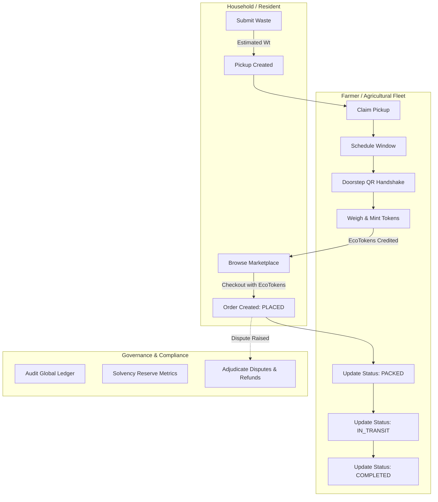

# Module 13: Postman Backend API Documentation & Automated Testing

The **AgroLoop Postman API Suite** provides exhaustive interactive documentation, automated contract tests, and pre-configured multi-role authentication environments for testing and integrating with the AgroLoop Spring Boot REST API.

---

## 1. Overview & Directory Architecture

The Postman artifacts are located in the [`postman/`](../../postman) directory:

```text
postman/
├── AgroLoop_API.postman_collection.json      # 66 production-ready REST endpoints
├── AgroLoop_Local.postman_environment.json   # Local Spring Boot environment variables
└── README.md                                 # Quick start and Newman test runner guide
```

---

## 2. Authentication Scenarios

### 2.1 Zero-Config Dev API Key (`X-API-Key`)
Designed for frictionless external logistics, Postman manual testing, and developer environments:
- Header: `X-API-Key: agroloop-dev-key`
- Behavior: Handled by `DevAuthenticationFilter.java`. Grants full administrative and cross-role authority (`ROLE_ADMIN`, `ROLE_FARMER`, `ROLE_HOUSEHOLD`).
- In Postman: The collection's **Pre-request Script** automatically attaches this key to requests when `apiKey` is set in the environment.

### 2.2 Standard RSA-Signed Bearer Tokens (JWT)
Designed for role-boundary security testing:
- **Login Request**: Execute `POST /api/v1/auth/login` under folder `2. Authentication & Sessions`.
- **Automatic Token Ingestion**: The collection test script extracts `accessToken` and automatically populates the `bearerToken` environment variable:
  ```javascript
  const jsonData = pm.response.json();
  if (jsonData.accessToken) {
      pm.environment.set("bearerToken", jsonData.accessToken);
  }
  ```
- All subsequent folder endpoints inherit `Authorization: Bearer {{bearerToken}}`.

---

## 3. End-to-End Operational Lifecycle Workflows



---

## 4. API Endpoints Reference Matrix

| Category | Endpoint | Method | Key Parameters / Payload | Description |
| :--- | :--- | :---: | :--- | :--- |
| **System** | `/api/v1/health` | `GET` | — | System health status & database connectivity probe. |
| **System** | `/api/v1/meta` | `GET` | — | Authoritative platform and version metadata. |
| **Auth** | `/api/v1/auth/login` | `POST` | `email`, `password`, `clientType` | Authenticates actor, returns access & refresh tokens. |
| **Auth** | `/api/v1/auth/refresh` | `POST` | `refreshToken`, `clientType` | Cryptographic rotation of refresh token session. |
| **Auth** | `/api/v1/auth/me` | `GET` | — | Fetches current user profile and role details. |
| **Marketplace** | `/api/v1/marketplace/categories` | `GET` | — | Lists circular product categories. |
| **Marketplace** | `/api/v1/marketplace/products` | `GET` | `keyword`, `category`, `page`, `size` | Paginated product browsing with filters. |
| **Orders** | `/api/v1/orders` | `POST` | `items`, `deliveryAddress`, `Idempotency-Key` | Atomically places order debited from household balance. |
| **Orders** | `/api/v1/orders/{id}/status` | `POST` | `status: "PACKED" \| "IN_TRANSIT" \| "COMPLETED"` | **Producer & courier order lifecycle updates.** |
| **Orders** | `/api/v1/orders/{id}/complete` | `POST` | — | Marks order as fulfilled and completed. |
| **Orders** | `/api/v1/orders/{id}/cancel` | `POST` | `reason` | Cancels order and triggers atomic ledger refund. |
| **Orders** | `/api/v1/orders/{id}/dispute` | `POST` | `disputeReason` | Escalates contested order for admin arbitration. |
| **Household** | `/api/v1/household/balance` | `GET` | — | Real-time available and pending EcoToken balances. |
| **Household** | `/api/v1/household/ledger` | `GET` | — | Double-entry ledger history for current household. |
| **Household** | `/api/v1/household/waste-submissions` | `POST` | `category`, `estimatedWeight` | Submits segregated bio-waste for collection. |
| **Farmer** | `/api/v1/farmer/pickups/available` | `GET` | — | Discovers unclaimed waste batches within farm radius. |
| **Farmer** | `/api/v1/farmer/pickups/{id}/verify` | `POST` | `verifiedWeight`, `qualityGrade` | Certifies weight and mints reward EcoTokens. |
| **Farmer** | `/api/v1/farmer/routes/optimize` | `POST` | `pickupIds`, `routeDate` | Generates TSP-optimized waypoint itinerary. |
| **Handshake** | `/api/v1/pickups/{id}/handshake/pass` | `POST` | — | Issues ephemeral 6-digit PIN and Ed25519 signed QR. |
| **Handshake** | `/api/v1/pickups/{id}/handshake` | `POST` | `method`, `passCode` or `payload` | Verifies physical doorstep exchange. |
| **Reviews** | `/api/v1/reviews/orders/{id}` | `POST` | `rating`, `comment` | Submits 1-5 star review and testimonial. |
| **Admin** | `/api/v1/admin/solvency` | `GET` | — | Calculates systemic reserve ratio and token velocity. |
| **Admin** | `/api/v1/admin/ledger` | `GET` | `page`, `size` | Global double-entry platform audit ledger. |
| **Admin** | `/api/v1/admin/orders/{id}/dispute/resolve` | `POST` | `resolution: "APPROVED_REFUND" \| "DISMISSED"` | Adjudicates dispute and executes atomic refund. |

---

## 5. Headless Command-Line Execution (Newman)

To execute the entire collection in continuous integration or pre-commit checks:

```bash
newman run postman/AgroLoop_API.postman_collection.json \
  -e postman/AgroLoop_Local.postman_environment.json \
  --bail
```
